# Feature tour

Oxygen runs an orienteering event in the browser, from the first entry to the last result. This page is the short tour: a picture and a few lines per area. Each area links to its guide page, which has every detail.

The demo shots come from the **Demo Competition**, a committed fixture on a Swedish forest map from o-kartan.se ([demo guide](ops/demo.md), [demo map](ops/demo-map.md)); some show a club map, published as images with the club's permission. [screenshots/README.md](screenshots/README.md) explains how they are made.

## Set courses on the map

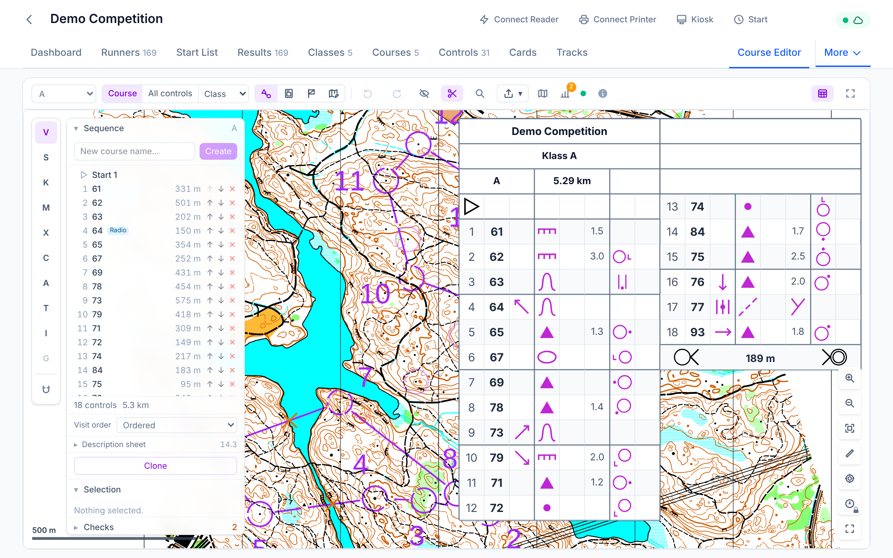

The course editor works on the event's own map. Click to place a control: Oxygen picks the next free punch code, suggests the control description from what the map shows under the circle, and draws legs, numbers and the cuts around features as you go. Forks and butterfly loops, several starts, radio controls and a full IOF description editor are built in, and two setters can work on the same event at once.

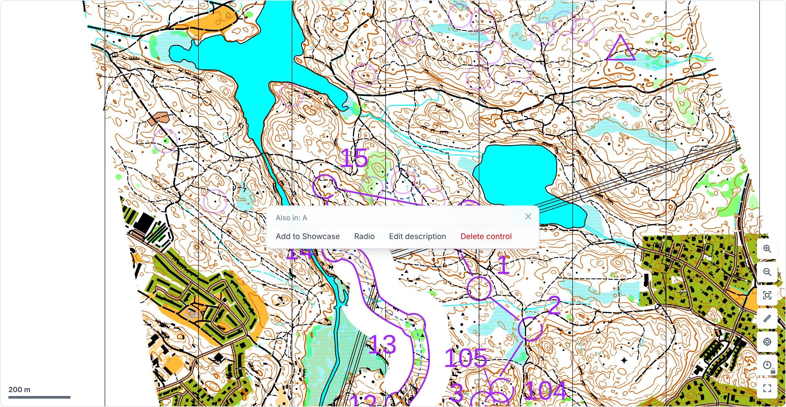

[Course editor guide →](guide/course-editor.md)

## Print-ready course maps

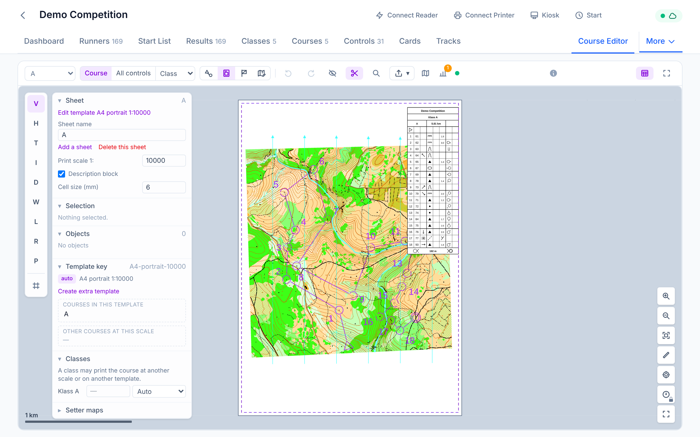 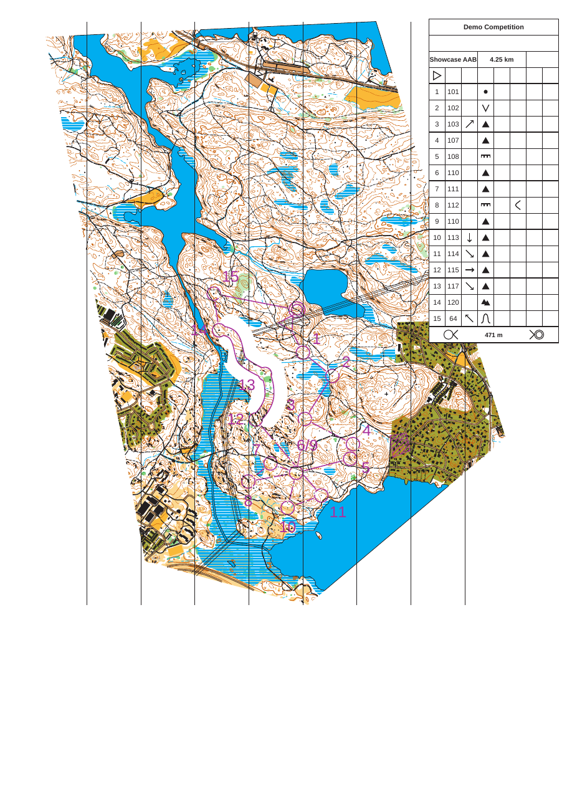

Layout mode lays out the printed sheet on the same canvas: frame, description block, title, logos and text. Export a PDF of one course, every variant of a forked course, or one map per runner, at the print scale you set. Courses also export as IOF XML or Purple Pen.

[Course maps and printing guide →](guide/course-maps-print.md)

## Your map, drawn properly

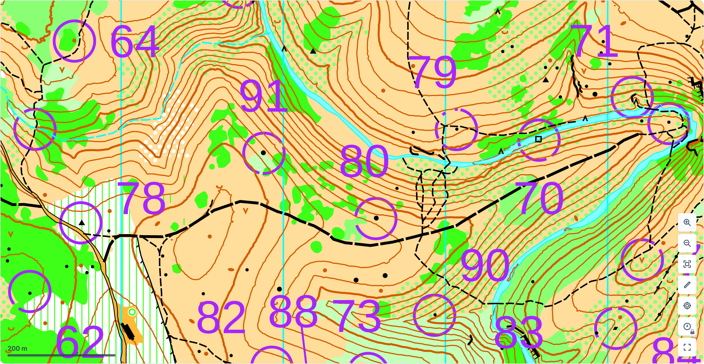

Upload an OCAD or OpenOrienteering Mapper file and Oxygen draws it as vectors with WebGL, in the IOF colour order, sharp at any zoom. Map mode corrects the map on the spot, and the corrections follow their objects when a new edition of the map is imported.

[Maps, terrain and GPS tracks guide →](guide/maps.md)

## In the forest with a phone

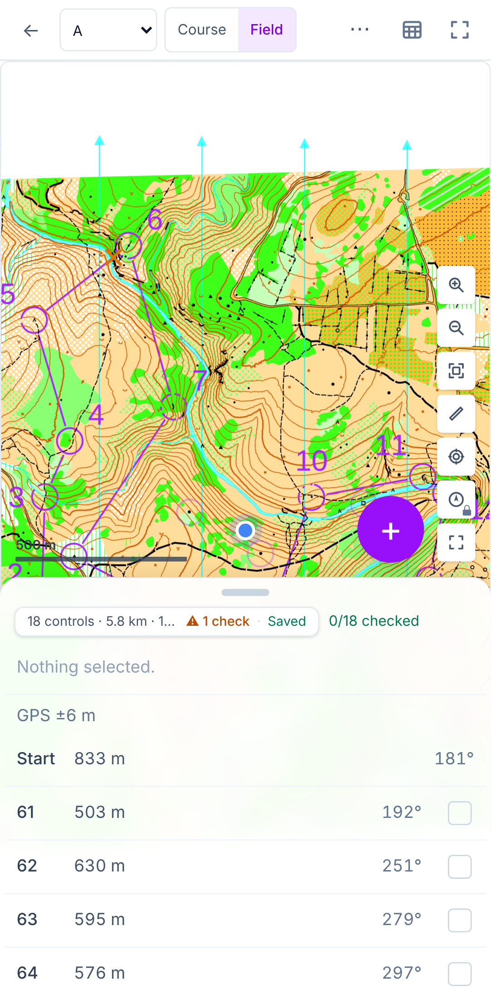

Field mode is for hanging controls. It shows your GPS position on the map, the distance and bearing to every control of the course, and a checklist to tick off. It works offline, and moves and check-offs sync when you are back in coverage.

[Course editor guide →](guide/course-editor.md)

## SI readout in the browser

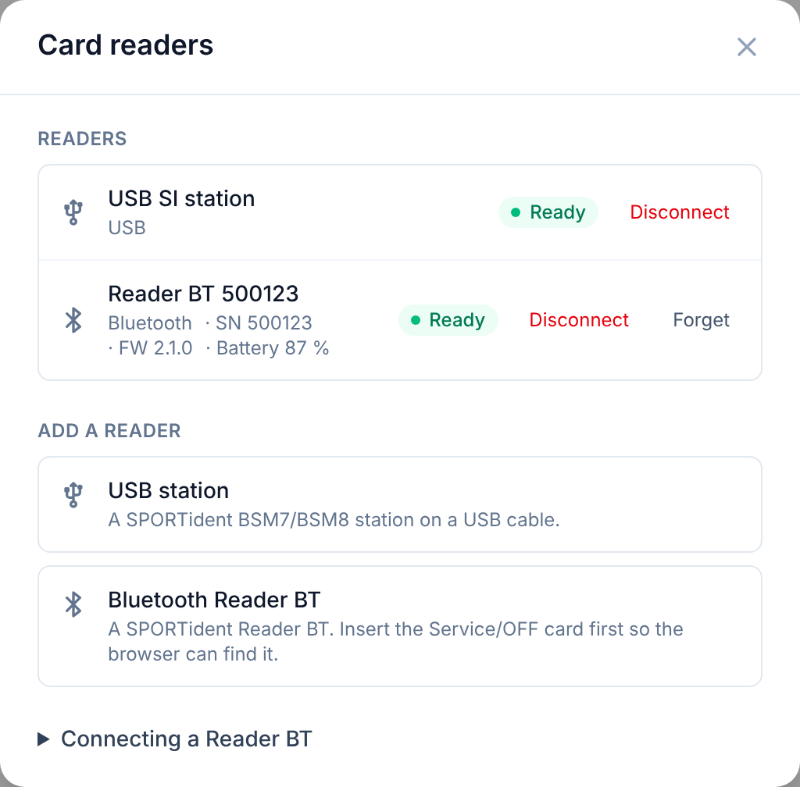

SPORTident cards are read straight from Chrome or Edge: a BSM7/BSM8 station over USB, or the battery-powered Reader BT over Bluetooth, several at once. Each readout is matched to its runner and checked against the course on the spot.

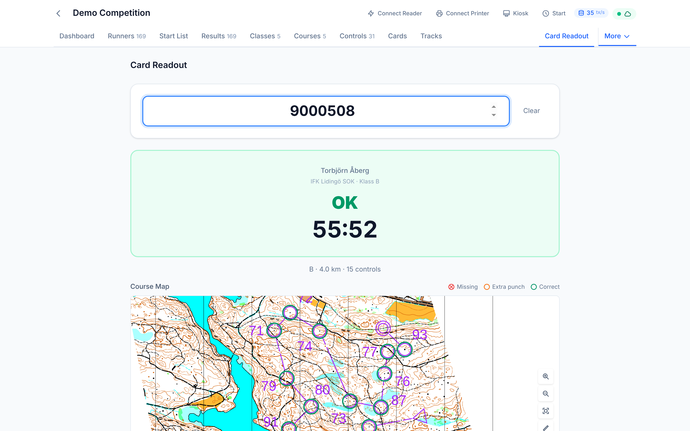

[Race day and results guide →](guide/race-day.md) · [Platform guide, card readers →](guide/platform.md#card-readers)

## Race day

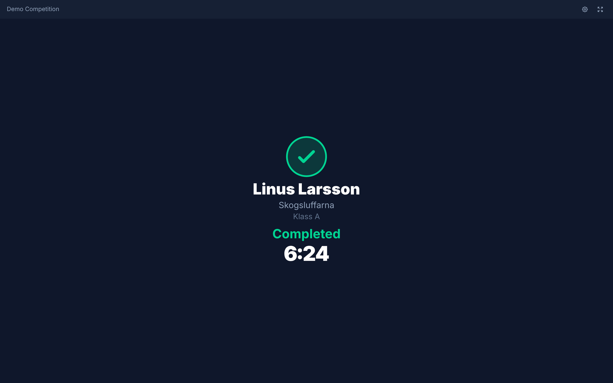

A kiosk screen at the finish shows each runner their result the moment the card is read, or exactly what went wrong. Start and finish stations, backup punches, a receipt printer and an arena start screen cover the rest, and the dashboard shows who is still out.

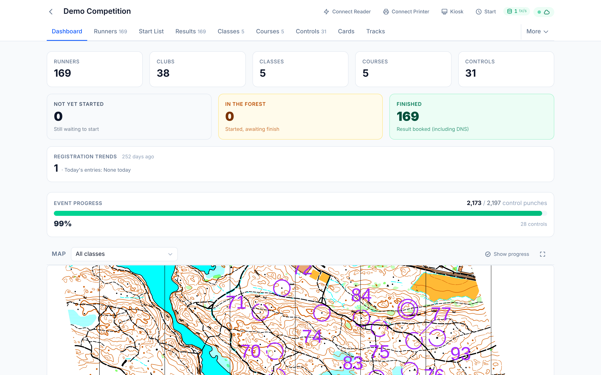

[Race day and results guide →](guide/race-day.md)

## Results and LiveResults

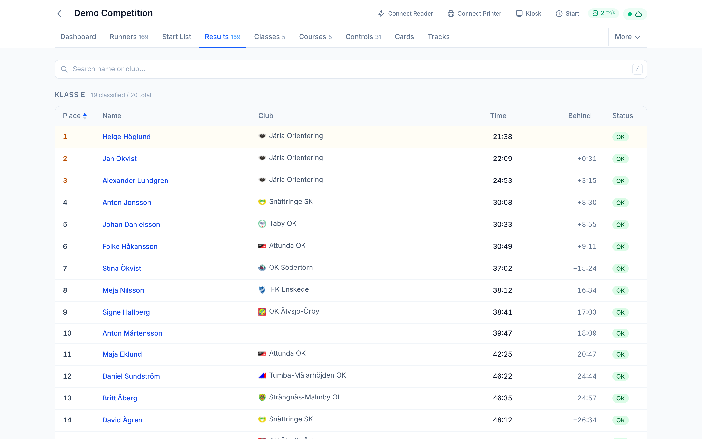

Results build up live as cards are read. Oxygen pushes splits to liveresultat.se during the race and uploads results and start lists to Eventor afterwards.

[Race day and results guide →](guide/race-day.md)

## Entries, classes and the start draw

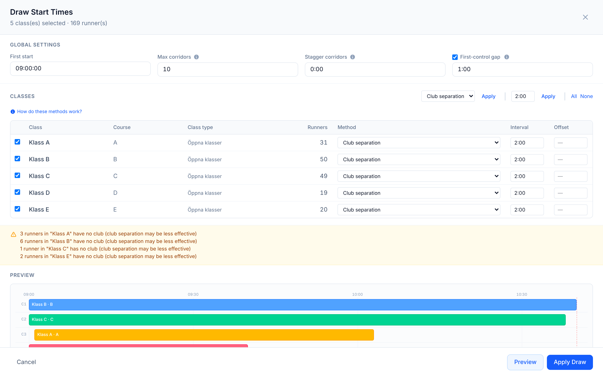

Import the event, its entries and clubs from Eventor, or enter them by hand. Classes, controls, runners and clubs each have their own page with search and bulk editing. The start draw spreads classes over parallel start corridors and shows the result on a timeline before anything is saved.

[Event setup, entries and the start draw guide →](guide/event-setup.md)

## Terrain and GPS tracks

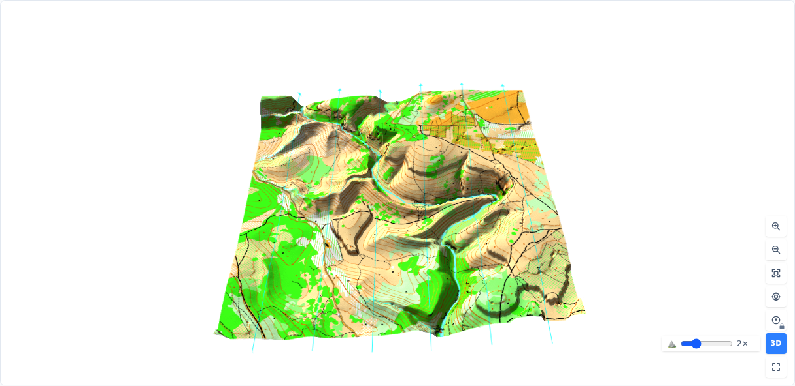

With height data configured, the map can be draped over the terrain in 3D. GPS tracks imported as GPX or TCX are drawn on the map and on the terrain, and the Tracks page shows each stored route filtered to the runner's own course.

[Maps, terrain and GPS tracks guide →](guide/maps.md)

## Runs anywhere, even offline

Oxygen is an installable PWA: stations cache the event, queue what they record while the network is down, and sync when it returns. Several competitions run side by side on one server, in English or Swedish, and a one-shot CLI moves a MeOS database into Oxygen. Test Lab simulates a whole race for training and testing.

[Platform guide →](guide/platform.md)

## Try it

The [demo guide](ops/demo.md) starts Oxygen with the Demo Competition in about two minutes, locally with Docker or in Google Cloud Shell. To load the same fixture into your own PostgreSQL, run `pnpm showcase:load` ([scripts/load-showcase.sh](../scripts/load-showcase.sh) lists its options).
