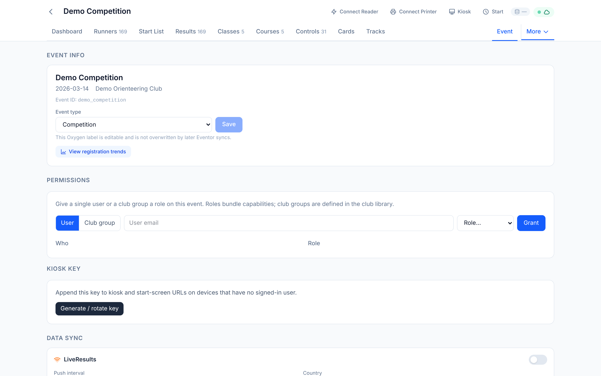
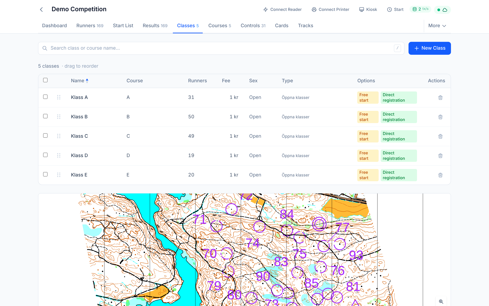
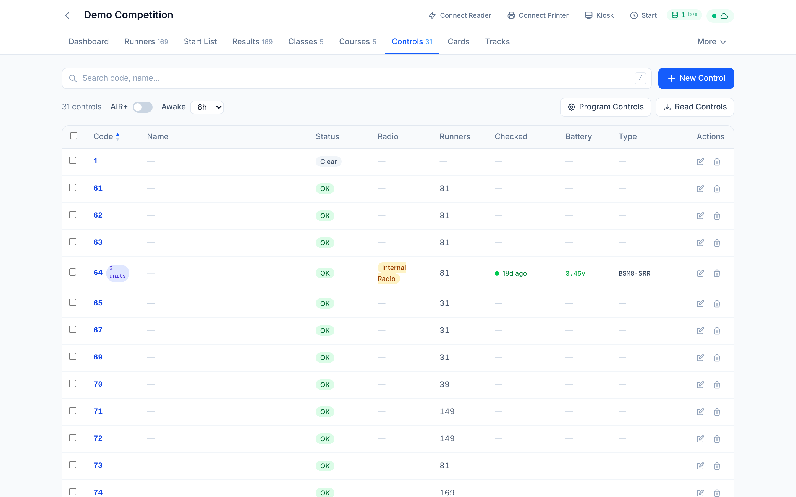
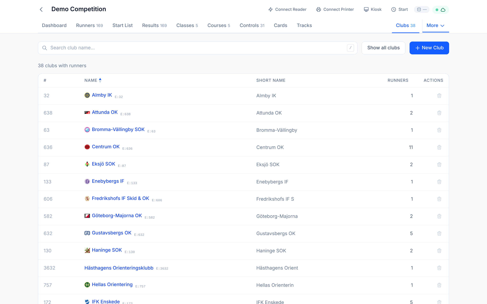
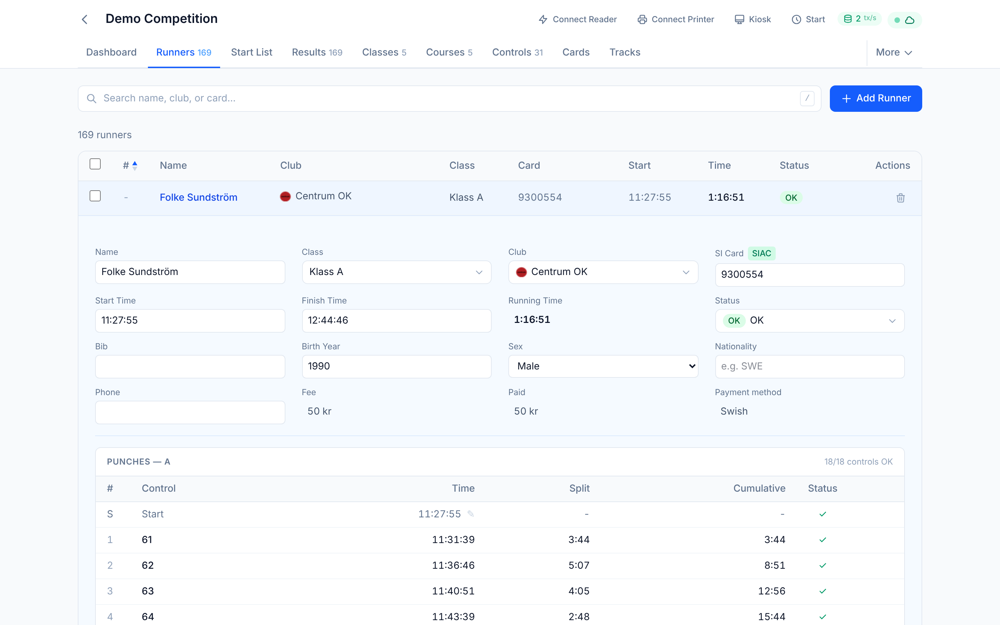
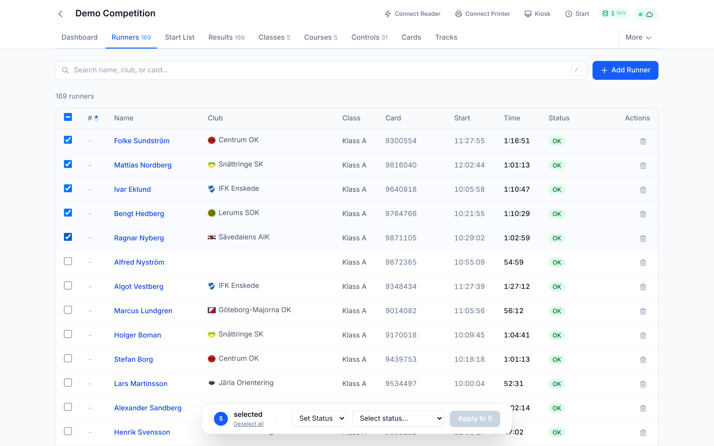
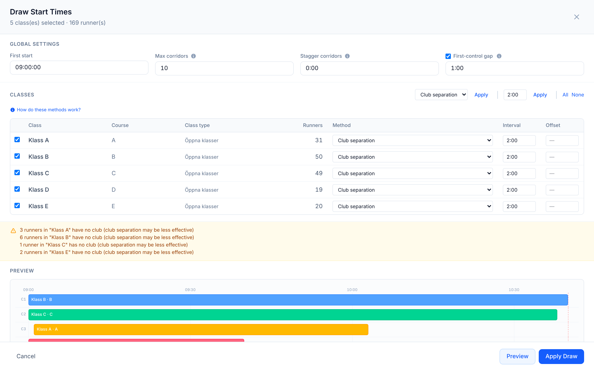
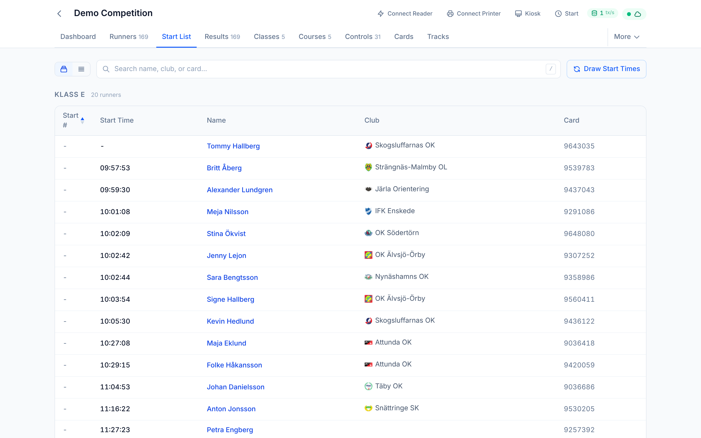

# Event setup, entries and the start draw

Creating an event, Eventor import, classes, controls, clubs, runners and the start draw. This page is the detail behind the [feature tour](../features.md).

## Event setup and Eventor integration

The event page is mission control for external integrations. Everything the Swedish orienteering stack relies on is wired into one screen:

- **Zero time and time zone** — every race time is counted from the event's
  zero time. The new-event dialog asks for the planned first start (default
  10:00) and sets the zero time one hour earlier; a start exactly on the zero
  time cannot be stored, so keep it before the first start. Both the zero time
  and the time zone (which sets the clock of the start and finish stations,
  the kiosk and the start screen) are under Event Info. Moving the zero time
  keeps every drawn start at its clock time; it locks once the race has
  finish times, punches or read cards, and while the event is checked out to
  a venue. The time zone can always be changed. See [system/registration-and-readout.md](../system/registration-and-readout.md), "Time model".
- **Editable event type** — choose a competition, training, weekly course, or
  custom label during creation and change it later under Event Info. Eventor
  initializes the label on import but later syncs cannot overwrite it; raw
  Eventor classification remains separate for reporting. See
  [system/event-types.md](../system/event-types.md).
- **Eventor sync** — import entries, classes, clubs, competitors, and published class-course lengths; upload start lists and results in the IOF XML formats Eventor expects. **Sync from Eventor** first shows a preview (runners and classes added or changed, who would be marked as withdrawn, who is kept because they already have a card read or a result) and applies it only when you confirm. A re-sync never undoes what you did at the desk: a card, class, name or club you changed stays, and a runner whose value now differs from Eventor's shows "Eventor: X" with **Use Eventor's value** on the runner page; the runner search finds them with `eventor:differs` (or `eventor:gone` for runners no longer in Eventor). Times, status and start numbers are never touched by a re-sync. A sync is refused while the event is checked out to a venue. See [system/eventor-sync.md](../system/eventor-sync.md).
- **Global Runner Database** — download the federation-wide runner directory for fast name/card lookup at registration.
- **Club sync** — pull club metadata and logos.
- **LiveResults** — push live splits to [liveresultat.se](https://liveresultat.se) on a configurable interval.
- **Online Input (ROC)** — pull radio-control punches from [roc.olresultat.se](https://roc.olresultat.se) (or any ROC-protocol-compatible server) on a configurable interval. Punches land in the `punches` table tagged with their source so the result engine can deduplicate against later card readouts. See [docs/system/online-input-roc.md](../system/online-input-roc.md).

## Classes

Every class gets its own row of options: free start, no timing (for open / HD10-style classes), direct registration, and a maximum allowed running time. The table also shows how many runners, which course, and the class leg / length directly. The Club library's **Classes** tab stores the recurring catalogue once; a new event can bulk-add the relevant presets while preserving all settings and skipping names already present. Course creation then suggests classes that still lack a course, and an exact name selection links the new course to that class atomically.

**Forked courses: variants pre-set per runner.** A class on a course with variations (a butterfly or a loop) runs its variants, and every runner in it has one before the race — a runner entered at the desk, from the Registration dialog, an Eventor sync or offline gets the variant with the fewest runners so far. The class's detail lists the variants with their runner counts and a **Distribute variants…** action that deals them over the class in start order (or randomly), so consecutive starters get different variants; by default only runners without one are dealt, and runners who have already raced always keep theirs. Run it after the draw. The readout checks a runner against her own variant only, so running another variant is a mispunch — and when a mispunched runner's punches match another variant of her class completely (she was handed the wrong map), the Runners page and the readout station say so ("Punches match variant B completely") with an **Accept variant B** button for the official at the red exit, which switches her variant and makes the run OK; nothing switches automatically, the kiosk only tells the runner to see the official, and the button needs the server. See [course-controls-and-matching.md](../course-controls-and-matching.md) "Forked courses and variants".

## Controls and SI units

The Controls page tracks two things side by side: the logical controls used in course definitions, and the physical SI station units that fulfill them. A single logical control can own multiple units — for redundancy at the same location, or after a mid-race unit swap with a different code.

Battery voltage, last-checked time, programmed code, firmware, and hardware type are tracked per unit, so two stations never overwrite each other's state. The list view also shows an aggregated **Type** column (`BSF8 / BSF9` when mixed units fulfill the same control), and unit rows expose capability badges such as **AIR+** where applicable.

Programming now performs a post-write SYS_VAL refresh before persisting battery data, which removes the old "freshly woken control shows exactly 3.00 V" artifact. The power-off sequence also returns the BSM8 to direct mode after OFF so the next coupling-coil probe doesn't immediately re-wake a just-programmed sleeping unit.

When a control is programmed from the UI, the unit row is upserted automatically; backup-memory reads are attributed to the reading unit too. The station's volts reading is converted to the millivolts the API stores, and a station that was programmed but whose record could not be saved now reports the failure instead of looking like a success — see [bugfixes/control-programming-battery-units.md](../bugfixes/control-programming-battery-units.md).

The pre-competition programming panel's target-control picker is ordered by control number rather than the import order the API returns, so a code can be found by scanning.

Autosend follows the radio type rather than AIR+, since SRR transmission and contactless punching are independent features. A check station or a plain control with an SRR module therefore gets the protocol-level autosend gate without entering beacon mode, while clear and readout stations no longer offer a variant they would discard — see [bugfixes/check-station-autosend.md](../bugfixes/check-station-autosend.md).

The structured search bar supports an `ordinal:` filter for a control's position within a course, matching when any course has it at that position — `ordinal:1` lists every course's first control, `ordinal:-2` the second-to-last before finish (negative values count from the end), and comma lists combine (`ordinal:1,-1`).

## Clubs

Clubs are pulled from Eventor (or entered manually) and rendered with their real logos in every view — runner rows, start list, results. It's a small thing but goes a long way on a public results screen.

## Registration trends

The registration trend page (overflow nav → **Trends**) plots when runners signed up for the competition — useful both retroactively and during the countdown days when last-minute entries decide whether you need extra start corridors. The same chart can overlay comparable historical events from Eventor; the curves are aligned by *days before race* so different events with different start dates can be compared at a glance. See [system/registration-trends.md](../system/registration-trends.md) for the data sources, cache strategy, and rate-limit handling.

## Runner list and bulk editing

Every registered competitor is on one page, with class, club, SI card, and status visible at a glance. Click any row to expand an inline detail pane — name, class, club, card, bib, times, punches, and status are all editable in place. A field saves when you pause typing, press Enter or leave it, and closing the row saves what is still pending. If the server refuses a change (a card another runner holds, an empty name), the pane says why and the field shows the stored value again. In a class on a forked course the pane also has a **Variant** select to change the runner's variant by hand; the start list shows the variant after the class (`H21 · AC`).

Select multiple rows and the floating action bar appears: change class, status, or club for all selected runners at once without leaving the page.

## Start draw

The draw engine allocates start times with configurable methods:

- **Club separation** — prevents runners from the same club starting back-to-back.
- **Random** — simple random allocation within each class.
- **Seeded** — preserves a specific order (e.g. ranking-based).
- **Simultaneous** — mass start for all runners in a class.

The first start defaults to one hour after the zero time. Times are typed as
clock times (`10:00`, `10:00:00`) and intervals as minutes:seconds (`1:30`) or
whole minutes (`2`); a value that does not parse is shown in red and blocks the
preview, and every class except a mass start needs an interval of at least one
second. The preview refuses to apply a draw with a start exactly on the zero
time or one that runs past midnight, and says why.

The graphical timeline shows how classes are distributed across corridors (parallel start lanes) and time. Each bar covers the class's whole start window, up to and including the last runner's slot, so consecutive classes in a corridor meet edge to edge. Classes on the same course share a corridor and run one after another. Drag class bars to rearrange the schedule and re-run the draw without losing context.

Three settings control how the parallel lanes are phased:

- **First-control gap** (global, MM:SS, default 1:00) is the minimum time between any two runners heading for the same first control. Classes that share a first control still run in parallel — the draw interleaves them. Two classes on a 2-minute interval sharing control 31 end up on alternating minutes rather than one waiting out the other. Unchecking the box next to the field turns the constraint off entirely.
- **Stagger corridors** (global, MM:SS) shifts each corridor relative to the previous one, wrapped within the class interval. With 8 lanes on a 2-minute interval and a 1-minute stagger you get 4 starters every minute instead of 8 every second minute.
- **Offset** (per class, MM:SS) shifts a single class's block. For the first class in a corridor it replaces the corridor's stagger phase; for a stacked class it shifts the block relative to where it would otherwise land.

If a class's own start interval is shorter than the first-control gap, the draw warns — its runners are already closer together at the control than the gap allows.
The draw also warns when two classes sharing a first control still send runners there closer than the gap, for example two classes pinned to the same first start.

### Redrawing during an event

A draw never moves a runner who has started: anyone with a finish time, a result (OK, MP, DNF, DQ), a read card or a stored punch keeps their start time and start number, and the preview says how many were kept. Only classes nobody has drawn yet are preselected when the panel opens; classes that already have start times show a *drawn* badge, and classes with finished runners a *started* badge.

- **Only runners without a start time** draws just the late entries. They are placed after the class's last start (in a mass start, at the same time as the field), and the class's own first start and interval stay as they are. These classes are not shown in the timeline.
- **Also redraw runners who have started or finished** appears when the selection has such runners. It puts them back in the draw; their running times will change.

When Apply would replace start times that are already set, the panel asks first and says how many. Apply writes exactly the order shown in the preview. If runners or classes change in between (a late entry, a class change), Apply refuses and asks for a new preview. Moving a class in the timeline keeps the runner order.

Start numbers continue after the highest number the draw does not touch, so redrawing one class never reuses another class's numbers.

After applying the draw, the start list shows every runner with their allocated start time — ready to print or sync back to Eventor.

