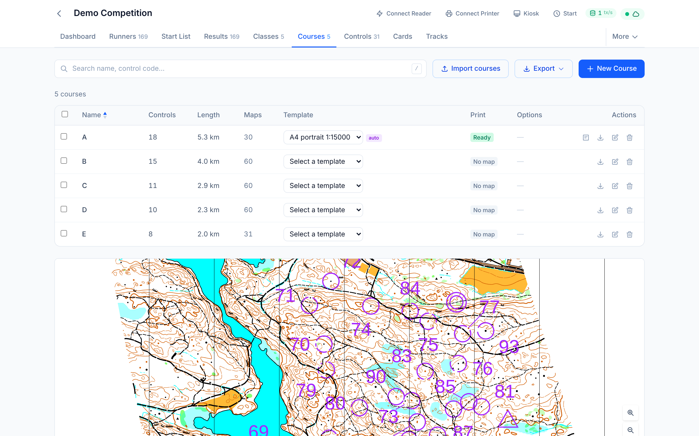
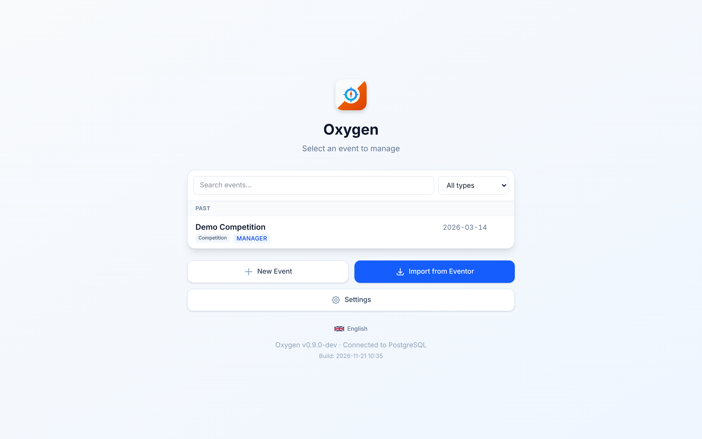
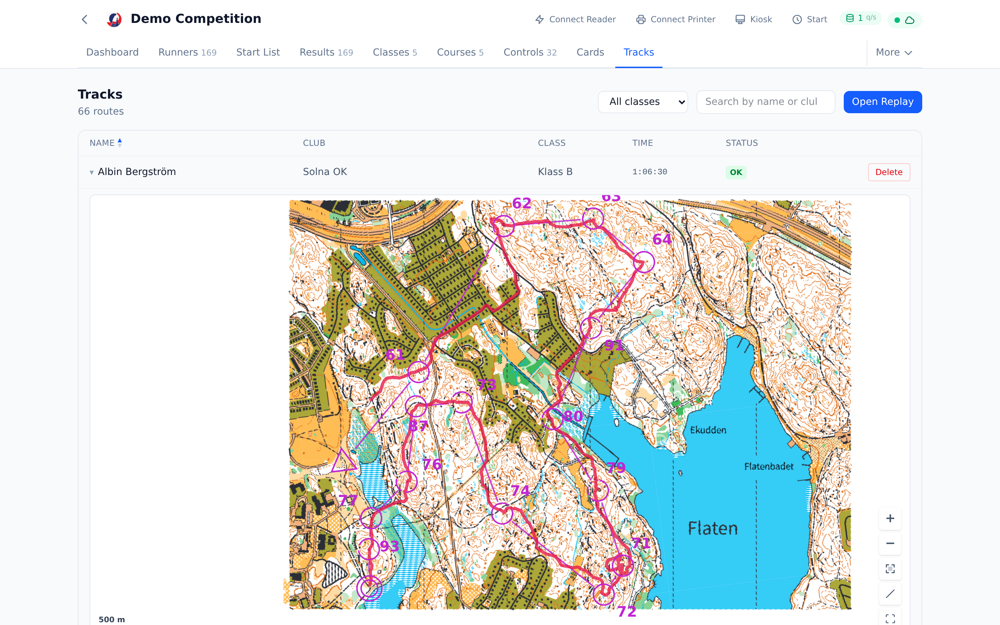

# Maps, terrain and GPS tracks

Uploading and rendering the orienteering map, height data and 3D terrain, and GPS tracks after the race. This page is the detail behind the [feature tour](../features.md).

## Courses and the map

Courses come from OCAD (`.ocd` / `.xml` course export), IOF XML, Purple Pen (`.ppen`), or can be authored directly. An OCD import keeps what the file drew beyond the sequence — slits in control circles, gaps in legs, marked routes and out-of-bounds lines and areas — as stored cuts, gaps and course objects, so the vector map and print draw them without reading the file's geometry; re-importing replaces them (never an object drawn in the editor). A course can have **variations** (gafflingar) and **butterfly loops**: every concrete variant — the combinations of the alternatives, and every visiting order of a loop — becomes its own course named after the root and its key ("Long AC"), kept in step with the root on every edit, so timing, results and exports read each variant as an ordinary course. The Courses page lists the variants under their course, with an "N variants" badge; click a variant to see its own control sequence (read-only, highlighted on the map and deep-linkable like a course); classes on the course pool its variants (see [course-layer.md](../course-layer.md) §12). Variations and loops are authored in the course editor (below). A course can be set to **free order** (valfri ordning): controls may be taken in any sequence, the map and print drop connecting legs and sequence numbers (punch codes only), and card readout accepts any order. IOF export/import round-trips this via `CourseControl randomOrder="true"`. See [system/free-order-courses.md](../system/free-order-courses.md). The import preview auto-matches the file's class assignments to the event's classes — and when the file has none (common for OCAD exports and always for `.ppen`, where courses are simply named after classes), it falls back to suggesting classes from the course names (see [course-import-class-fallback.md](../course-import-class-fallback.md)). A guess by part of the name ("D1" for "D10") is marked but left on Skip, and a class the file puts on several courses is left for you to pick. The import has two modes: **Merge** (the default) adds and updates the file's courses and controls and leaves the rest; **Replace all** also removes every course and control the file does not have, and the classes on a removed course lose it. Before you import, the dialog lists what the chosen mode will do ("Removes 3 courses", "2 classes lose their course"). Either way, a control already in the event keeps the status you gave it (Bad, Optional), its extra codes and its name; a course keeps its length when the file has none; a forked course is left as it is under Merge. A file with no courses cannot replace all, and a file that lists a control or course twice, holds several races, or maps one class to two courses is refused with the reason, before anything changes. The import is all or nothing (see [course-layer.md](../course-layer.md) §6.4 "Import semantics"). Upload the map once and every view — dashboard, courses, tracks — renders against it. **3D view**: on a map with contours, the map's **3D** button (beside the compass) drapes the map — course included — over the terrain worked out from its contours, tilted 45°: drag to pan, scroll or pinch to zoom, right-drag (or Ctrl/⌘-drag) to turn and tilt, two fingers moving up or down together to tilt and twisting them to turn; the compass turns it north up again, and a slider sets the height exaggeration (1–5×, 2× by default, remembered per browser). Status rings, punch badges, class pills and the GPS position follow the terrain, and a GPS track (Tracks page, readout and runner previews) is drawn on the ground itself, hidden where a hill stands between it and the eye; the map's title, legend and margins are drawn too, at the edge's heights. 3D is offered in every map view except the course editor and the kiosk; a map without contours shows no button, a map whose contours are too uncertain (below 80 % with a known uphill side) or too large for the server says why, and a terrain that cannot be loaded or drawn falls back to 2D with the reason (see [map-rendering.md](../map-rendering.md) §5.4 "3D mode"). Where the instance has fetched a height model for the map, 3D offers two surfaces beside the exaggeration slider: **Map terrain** (the terrain from the map's contours, with their heights corrected by the height model when that makes them reliable enough) and **Ground** (the height model itself — "Ground (30 m)" for the coarser Copernicus model). Showing a GPS track, 3D opens on the ground, and the track lies on whichever surface is drawn; a map whose own contours are too uncertain for 3D still opens on the ground. Whenever a surface from the height model is drawn, its credit is shown in the map's corner ("Elevation data © Lantmäteriet, CC BY 4.0"), as the licence requires. Every map is drawn from the event's map document by the vector map engine (the classic image tiles and the *Use new map engine* switch are gone since v0.6.0). While a newly uploaded map is still being prepared the map panel says so, and a map whose import waits for review links to the review; a browser that cannot draw the map (no WebGL2) says so instead of showing a map. On the vector engine the course is drawn as part of the map, in the printed colour order — circles and legs sit under the map's black, brown and blue line art and over its yellow, green, blue and grey area fills as on a printed course map (a map that draws an area colour above the course purple is reported on import, see [bugfixes/lower-purple-under-areas.md](../bugfixes/lower-purple-under-areas.md); the course's purples are placed by that order on every import, whatever purples the map file itself keeps and wherever it keeps them — the map's own purple objects stay drawn where the mapper put them, see [bugfixes/course-purples-under-map.md](../bugfixes/course-purples-under-map.md)), with the control numbers (and their leader lines) above it in upper purple, at the IOF symbol sizes for the map's scale (see [course-layer.md](../course-layer.md) §5). The map itself is drawn in the **IOF colour order**, not the order of the file's own colour table: each colour is placed by what it draws, so one colour the mapper uses for two things (a 50 % brown for both paved areas and road infill, one black for buildings and the dots of cultivated land) goes to both places — a building stays on top of its paved area, open land and other area fills stay under the course, black line art over it, however the file's table happens to be ordered. Where the file's own order differs on purpose it is kept: roads drawn over contours or over streams and ditches stay so by default (on such maps the contours and streams then lie under the course circles and legs), and colours the IOF order has no place for (masks, logos and frames, a club's own colours) stay where the file puts them. Every such difference is listed in the import report, kept or dropped. The review page's **Colour layers** panel shows the map's layers top first (each with the map's colour, its IOF layer, how many objects it draws and notes such as split, kept or dropped deviation, no IOF layer), every deviation kept or dropped with its default — each one can be kept or dropped for this map, or reset to its default, and the map is built again — a before / after picture of the map in both orders — **Compare** opens both versions (the one in use against this one, or the IOF order against the map's own order) as live maps, side by side with pan and zoom linked, or stacked with a swipe divider and **Flip** (Space), or as a **Diff** that marks every pixel that differs in red, with **Next / Previous difference** stepping from one changed area to the next — and a per-map switch between *the IOF order* and *the map's own order*: the switch is remembered for the club map (across its versions, and copied to events that use it) or for the event's own map, every later import and re-match follows it, and the switched version is used once you press **Use this version** (see [map-symbols.md](../map-symbols.md) §8.7, §9.3). See [history/map-pipeline-switch.md](../history/map-pipeline-switch.md). Control circles are placed automatically from the course coordinate system. Club-wide base maps live in the club library, now the **Maps** tab of **Settings** (`/settings`): upload an OCAD file once, see the imported map's thumbnail, then **From club library** on the event map panel copies it into that event. A map whose import failed or is still running says so on its card and cannot be picked until it has imported. A map file that is cut short or damaged (an upload that stopped halfway, a corrupt file) is refused with "the map file is cut short or damaged … export or copy the file again and upload it" instead of importing with objects missing, and an import that stops the server on each of three attempts is given up and marked failed. **Review symbols** on the card (and in the course editor's map info dialog, for an event's own map) shows how each symbol of the file was matched to the IOF library — the file's own swatch beside up to three library suggestions with the reasons — most used symbols first; accept a suggestion, pick another library symbol, or keep the file's drawing, apply the decisions together, then **Use this version**. The review also has one terrain line: how much of the map's contours Oxygen could tell the uphill side of (the 3D view needs 80 %), or that the map has no contours — every imported map's terrain is worked out from its contours and stored beside it (see [map-storage.md](../map-storage.md) §4.7). An instance that switches it on (**Settings → Height data**, below) also fetches a height model for each imported map in the background — Lantmäteriet's (CC BY 4.0, © Lantmäteriet, with the club's own Geotorget account) or Copernicus GLO-30 where Lantmäteriet has none — and stores the ground surface and the contours anchored to it beside the map, for the 3D view's choice of surface (see [map-terrain.md](../map-terrain.md) §7 and [ops/deploy-gcp-cloud-run.md](../ops/deploy-gcp-cloud-run.md) "Height data"). Decisions are remembered for the whole club, so next year's edition of the map is matched the same way, and they travel to and from OpenOrienteering Mapper as a CRT file. Ski-O track symbols (ISSkiOM 2019: the 801–813 tracks, the snow-covered and unploughed roads, the prepared area, and the ski versions of 301 / 310) are recognised on any map beside its ISOM or ISSprOM symbols, drawn at the ISSkiOM track sizes for the map's scale, and every imported map carries the Ski-O green, orange and the white track mask in its colour stack, so a ski track can be drawn on any map (see [map-symbols.md](../map-symbols.md) §12). A card says how many symbols still wait for review. See [map-symbols.md](../map-symbols.md) §8.7. Later library edits do not change events that already copied the map. The OCAD file's own georeference is trusted as-is; what Oxygen checks is the map's drawn magnetic-north lines — an amber **north lines** badge (library card, the course editor's map info dialog, and a one-off notice after upload) says how many degrees they lag behind today's magnetic north, so a course setter knows when to redraw them before printing. The same page’s **Controls** tab holds prioritized punch-code series (own units first, borrowed ranges after). The course editor allocates those codes instead of the bare ≥ 31 heuristic, and SRR-flagged units become internal radio controls on placement. See [system/club-library.md](../system/club-library.md).

Control numbers are placed by a collision-aware algorithm: every number sits at the same visual distance from its circle, never on top of another circle, another number, or a drawn course line, and in congested clusters where a number cannot be nearest to its own circle it gets a thin leader line tying it to the right circle (see [bugfixes/control-number-placement.md](../bugfixes/control-number-placement.md)). In the course editor a setter can drag a number off its auto slot; the offset is stored per course and used on printed maps.

Selecting several courses shows all of them at once, with each leg labeled inline with the classes that run it — legs shared between courses carry the combined class list ("Öppen 1, Öppen 2"), so it's always clear which line belongs to whom. The labels render as pills embedded in the course line itself (exactly as tall as the line, centered on the visible span between the control circles), shrinking to fit short legs and disappearing rather than becoming unreadable — zoom in far enough for the line to carry them. With a single course selected, the Descriptions toggle renders a classic control card with sequence numbers (1, 2, 3, …); with several courses it keeps control codes on the map (no renumbering) and shows one combined, code-sorted description sheet covering every control on the selected courses. Map rotation is locked north-up by default — an accidental two-finger twist while pinch-zooming will not turn the map. The always-visible compass button cycles through the states: tap to unlock two-finger rotation, tap a rotated view back to north-up, tap again to relock; the choice is remembered per browser.

## Height data

**Settings → Height data** (`/settings?tab=terrain`), an instance-admin
tab beside Eventor, configures the height model the 3D view uses. It
explains on the page what the model is for (the real ground surface,
absolute heights for the map's own terrain, GPS tracks on the ground),
the two providers — Lantmäteriet (Sweden, 2 m or 1 m, free under CC BY
4.0, needs a Geotorget account) and Copernicus GLO-30 (worldwide, 30 m,
no account) — and how to get the account: create a user on Lantmäteriet's
Geotorget, order the free *Markhöjdmodell Nedladdning*, enter the user
name and password here. The tab switches each provider on or off, saves
the account (the password is stored encrypted, is never shown again —
the tab shows only the user name and when it was saved — and is sent only
to Lantmäteriet), sets the resolution, and runs **Test connection** on a
club map, which checks the account and Lantmäteriet's download service
and shows the result. Below, every club map's height-data state, with
**Retry** for a map whose fetch failed, and for a ready map the level the
height model was read at ("read at 2 m"). A map too large for the chosen
resolution (over 64 million height cells, e.g. a 1:15 000 map spanning
20 × 17 km at 2 m) is read one level coarser instead — "read at 4 m, one
level coarser" — from the same download; only a map too large at that
level too stays without height data, and the tab says which limit it hit
(too many tiles, too many height cells, too many search pages, or the
map's own height-field limit). Maps that had ended "too large" before
this are tried once more when the server starts. Saving an account queues every
map that failed on the old one, with no restart. A value saved here wins
over the deploy's `MAP_DEM_*` variables; with nothing saved and nothing
deployed, no height data is fetched (see [map-terrain.md](../map-terrain.md)
§7.8).

When `AUTH_MODE=proxy` (or `dev`), the selector and event shell require a
signed-in user. Identity comes from a trusted reverse-proxy header — Oxygen
never stores passwords. With `AUTH_AUTO_PROVISION=member` (Cloud Run),
anyone IAP admits is created as a plain member on first sight; otherwise
the account must be invited. Instance admins manage people from **Settings
→ Users** (`/settings?tab=users`) — display name, role, club groups, last
seen, and active. Per-event **roles** (Event admin, Course setter, Race crew,
Member) hide tabs and block APIs the user is not granted; a role can be
given to a single user or to a **club group** — a named set of users
defined on the Settings page's Groups tab, whose membership changes apply
to every granted event immediately. After a race is completed, every
invited user can view courses, maps, and results. Kiosk and start screen
stay reachable without an invite when the URL includes a kiosk key
(`?k=`); see [system/authentication.md](../system/authentication.md). Club OCAD source
files stay behind admin (or the library uploader); see
[system/club-library.md](../system/club-library.md#ocad-source-files).

Inside an event, the admin tab bar starts with planning pages (Dashboard, Classes, Courses, Controls, Course editor). Runners, start lists, results, cards, and tracks move into the More menu until the event has entries or results — they are never unreachable. Race-day stations stay in More.

The Oxygen mark at the top of the competition list — an orienteering flag
with a compass-rose "O" — is a **live compass** on phones: the needle turns
to real north from the device orientation sensor. On iOS the first tap on
the logo asks for motion permission — once only, since the grant is
remembered and silently restored on later app starts; on Android it just
works; on a desktop without a sensor the needle rests at north. The same
mark is the favicon and the PWA / home-screen icon. See
[system/app-icon.md](../system/app-icon.md).

## GPS tracks

GPS routes live in a `routes` table alongside the rest of the event data, with nullable foreign keys to `runners` / `classes` so unmatched routes still appear and can be reconciled manually. They render on the same map the organizer uploaded.

Ingestion is currently out of scope: Oxygen reads and displays what is in the `routes` table but does not fetch tracks from any third-party service. The intended path forward is [Eventor's GPS-track upload](https://eventor.orientering.se), which is an official, organizer-authorized interface.

### Tracks page

A sortable table of every route with class and name filters, and structured search over name, club, class, time, and status. Expand any row to see the track overlaid on the competition map, filtered to the runner's course controls only — so the graph isn't cluttered with circles the runner didn't visit.

