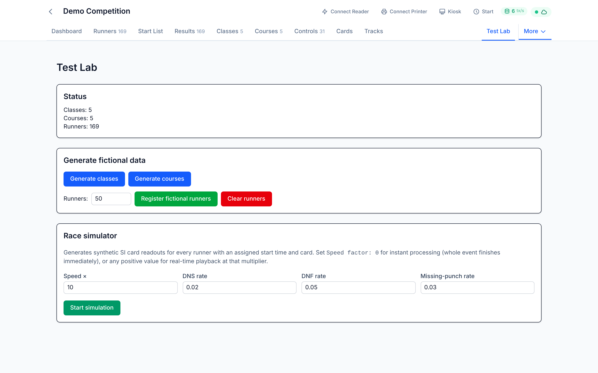

# Platform: offline, devices and settings

Phones and tablets, several competitions side by side, Eventor keys, offline operation, card readers, MeOS migration, settings, backup, Test Lab and languages. This page is the detail behind the [feature tour](../features.md).

## Mobile and tablets

On phones and tablets the page zoom is locked, the competition shell header compacts to icon-only status pills with a sticky tab row, and inline maps nearly fill the viewport. One finger scrolls the page; two fingers pan and pinch-zoom the map. The course editor supports full touch editing (tap-select, drag-to-move controls, leg insert, dismiss button). Map toolbars include a **My location** control (Google Maps-style follow mode) for placing and collecting controls in the field. See [system/mobile-layout.md](../system/mobile-layout.md).

## Multiple competitions, side by side

Every event lives in the single `oxygen` database, scoped by `event_id`. The selector is the landing page — pick one and the whole app re-scopes to that event.

The list is grouped into **Upcoming** (`date >= today`) and **Past**, denser than the original card so clubs can keep many events loaded. A search box matches name, slug, annotation, and custom event type. The type filter uses Oxygen's editable type catalogue, including club training, weekly course, and a stable Other bucket for custom labels. When a user is signed in, a **My events** toggle narrows the list to events they hold a direct Event admin grant on — the ones they created or were made co-admin of (`EventInfo.ownedByMe`). An instance admin sees every event but owns none of them, so the toggle is a genuine filter for them too.

Creating an event asks for name, type, and date. For events created by an
invited user, the selector also shows that creator. The old per-event MySQL
host fields are gone.

The selector is laid out for phones as much as for desktops. The
signed-in user chip and language switcher live in the footer, under the
action buttons, instead of crowding the header; the "Select an event to
manage" tagline is desktop-only; the search box takes its own row on
narrow screens so the type select cannot run off the edge; the creator
attribution collapses to the bare name; and the per-row delete icon is
always visible on touch devices (it is hover-revealed only where
`(hover: hover)` holds, since a phone has no hover to reveal it with).

### Eventor API keys

The club's Eventor API keys — one for production, one for Test-Eventor —
are stored once per instance in `oxygen_settings` and shared by every
event. They are entered and removed under **Settings → Eventor**
(`/settings?tab=eventor`), which is an instance-admin tab; the
`eventor.validateKey` / `setKey` / `clearKey` mutations behind it are
`adminProcedure`, so a member cannot reach them through the API either.
Reading whether a key is configured (`eventor.keyStatus`) stays open to
any invited user because the import panel and the registration dialog
gate their UI on it. **Import from Eventor** on the selector therefore
no longer asks for a key: with none configured it links admins to the
Settings tab and tells members to ask an admin.

## Offline and PWA

Oxygen is a Progressive Web App designed to work during internet outages — from brief drops to full-day operation at forest venues with no connectivity.

- **Service worker** precaches all static assets, so the app loads instantly even offline.
- **Update prompt** — an open tab checks for a newly deployed bundle every minute and offers a reload, which activates the waiting service worker rather than serving the precached bundle again. The build timestamp is shown in the Sync Status footer and on the competition list, so a stale tab is recognisable — see [bugfixes/stale-web-bundle-after-deploy.md](../bugfixes/stale-web-bundle-after-deploy.md).
- **IAP session recovery** — if a dormant installed PWA wakes with an expired Google IAP cookie, `/trpc` fails as CORS `Failed to fetch`. Oxygen asks the server once whether the session expired or the server is just unreachable. An expired sign-in over a page in use shows a **Your sign-in has expired** banner with **Reload**; a device that has nothing saved to show reloads by itself to refresh the cookie. An unreachable server never reloads anything — see [bugfixes/pwa-iap-session-recovery.md](../bugfixes/pwa-iap-session-recovery.md) and [bugfixes/station-outage-resilience.md](../bugfixes/station-outage-resilience.md).
- **Server unreachable** — a station keeps working for the whole outage. An event opened on the device before opens from its saved data even after a reload, with an amber **Offline: showing saved data** pill in the header, and reconnects by itself when the server answers again. An event never opened on the device shows **Cannot reach the server** with **Retry** and keeps trying. Queued writes are retried by themselves (every few seconds, at most every 30 s) until they go out. A page that fails to render shows an error inside the page; the header, tabs and an open registration stay.
- **Pre-fetch on station pages** — runners, classes, courses, controls, and clubs are cached to IndexedDB when a start/finish/kiosk station mounts, and survive browser restarts and overnight power-off.
- **Event-based mutation queue** — all finish recordings, registrations, and edits are stored locally and drained to the server when connectivity returns. A visible banner tells you how many events are queued.
- **Local result computation** — the finish station runs the same course matching, status rules, and position ranking as the server, so it can print a valid receipt from cached data even while the network is down.
- **Clock-skew warning** — every queued mutation is stamped with a hybrid logical clock, and each sync compares this device's clock to the server's. If they differ by more than 30 seconds a persistent banner warns that times recorded here may be inaccurate.
- **Printing on a venue box** — an event checked out to a venue box brings its course-map sheets, templates, course objects and logos along, so the box prints course maps and description sheets itself, the same bytes as the cloud, even with no internet. An edit made on the box is forwarded to the cloud (it needs internet), so nothing edited there is lost at checkin, and the box shows it at once. While online the box also follows the cloud: a sheet, template or logo edited there, or a map re-imported there, reaches the box within the settings refresh interval (5 minutes by default); offline it keeps printing what it has. See [ops/venue-runbook.md](../ops/venue-runbook.md) and [course-print.md](../course-print.md) §8.7.
- **Event settings on a venue box** — while an event is checked out, the settings the arena changes on the day belong to the box: the kiosk key, rental-card fee, payment and receipt texts, AIR+ station settings, the Google Sheets backup and the time zone (the backup rows themselves are written by the cloud as the box's readouts arrive there, so a box offline at readout still gets them into the sheet). Change them on the box, offline too; the box sends them to the cloud every few minutes and at checkin, and the cloud refuses its own edits of them until checkin. Other event settings (name, organizer, fees, event type, LiveResults, Eventor) are edited on the cloud and reach the box within minutes. See [system/offline-architecture.md](../system/offline-architecture.md#the-event-row-during-a-lease).
- **Checking out and in at a venue** — checking an event out again over a copy the box already holds asks for confirmation when it would lose something: journal entries the cloud has not received, an event that was created on the box, or another event's logo or graphic that shares an id with one in the cloud's copy. If the cloud takes an event back while the box was off (force takeover), the box notices when it is back online, stops accepting race writes for that event and keeps delivering what it still holds. See [ops/venue-runbook.md](../ops/venue-runbook.md).

See [system/offline-architecture.md](../system/offline-architecture.md) for the technical details and [history/future-architecture.md](../history/future-architecture.md) for the post-MeOS vision with event sourcing — its **Phase 1** (HLC-stamped journal, one-card-per-event invariant, idempotent ingestion) landed in June 2026.

## MeOS migration

Oxygen began life as a MeOS-compatible Swiss-army knife and originally read/wrote the same MySQL layout as [MeOS](http://www.melin.nu/meos). That compatibility layer was retired in May 2026 in favour of a single PostgreSQL 18 database — see [`migrations/2026-drop-meos.md`](../migrations/2026-drop-meos.md) for the rationale and the one-shot CLI that moves an existing MeOS database into the new schema.

The status-calculation rules that originated in MeOS are still honoured by Oxygen's result engine: OK, DNF, Missing Punch, Over Max Time, No Timing, and Out of Competition. Per-runner flags such as `OutOfCompetition` and `NoTiming` are respected and surfaced as badges in the runner detail view.

## Settings

Everything that is club-wide rather than event-wide lives on one **Settings** page (`/settings`), reached from the button under the event list. Its tabs are Maps, Controls, Classes, and Groups (the club library, open to any signed-in user) plus Users and Maintenance (instance admins only). Maintenance holds **Clean up deleted records**, which permanently purges events that were soft-deleted from the event list. (Its **Map documents** card, the import of maps uploaded before the vector map pipeline, was retired in v0.6.1 with the legacy map storage; see [map-storage.md](../map-storage.md) §6.7.) The older `/library` and `/admin/users` URLs redirect here. See [system/club-library.md](../system/club-library.md).

Deleting an event from the start page is a soft delete: it disappears from the list, and the data survives until an admin purges it under Settings → Maintenance.

## Event backup

The Event page has a one-click **Download backup** button that streams a dump of the selected event to your browser: its courses, classes, runners, cards, punches, readouts, the journal, the map with its patch and colour settings, print templates and course maps, logos, tracks and access grants. Not other events, and not the shared runner and club directories or the users. The map travels as the content-addressed source file and imported document it pins, by hash. The dump is one consistent snapshot even during readout, and it ends with `-- BACKUP COMPLETE`; a backup that fails shows an error on the page instead of saving a partial file.

To restore it, run `pnpm db:migrate` and then `pnpm event:restore <file>` against the target database (`--replace` puts it in place of an existing copy of the event). The event comes back with every row, under a new internal id.

Venue boxes and self-hosted installs also take a whole-database backup every 15 minutes into a `backups` folder beside the compose file; the cloud has Cloud SQL's daily backups with point-in-time recovery. See [ops/backup-restore.md](../ops/backup-restore.md) for both.

## Card readers

Oxygen reads SportIdent cards directly in the browser: USB stations (BSM7/BSM8) through the Web Serial API, and the battery-powered **SPORTident Reader BT** through Web Bluetooth. Supported card types: SI5, SI6, SI8, SI9, SI10, SI11, SIAC, pCard, tCard over USB; the Reader BT reads SIAC, SI8–SI11 and pCard; it does not react at all to an SI5 or SI6, so runners with those need a USB station. No driver install, no desktop bridge — use any Chromium-based browser (Chrome or Edge, desktop or Android) and grant permission once per origin. Bluetooth needs a secure page (HTTPS or localhost), and Chrome on desktop Linux only exposes it after enabling `chrome://flags/#enable-experimental-web-platform-features`; a Linux host also needs BlueZ's LE supervision timeout raised (see [system/registration-and-readout.md](../system/registration-and-readout.md#1a-readers-and-the-reader-hub)) or the link drops after a few quick readouts.

The **Connect Reader** pill in the header opens the reader dialog, which lists every connected reader with its status, serial number, firmware, battery (Reader BT) and last card, and adds USB stations and Reader BTs. To add a Reader BT, insert its Service/OFF card so it advertises, press **Bluetooth Reader BT** and pick it; do not pair it in the operating system's Bluetooth settings. The reader beeps twice when Oxygen has read the card. If the link drops (the reader walks out of range, or the page is reloaded) the reader goes to sleep; Oxygen reconnects by itself the moment the next card is inserted, and reads that card. A Reader BT used before comes back the same way after a page load, and **Forget** removes it. Several readers can be connected at once (for example two readout stations at a busy finish), and every one feeds the same readout pipeline. USB stations the browser already has permission for reconnect by themselves when the page loads. See [system/registration-and-readout.md](../system/registration-and-readout.md#1a-readers-and-the-reader-hub).

## Test Lab

The built-in Test Lab generates realistic test data for development, demos, and stress tests. It works through four dependent stages:

1. **Generate classes** — a standard Swedish long-distance class setup (38 classes).
2. **Generate courses & controls** — 8 tiered courses with ~50 controls and realistic course sharing.
3. **Register runners** — distribute runners across classes using GDPR-safe fictional names (randomized Swedish names, mixed SI card types) or real runners from the Eventor database.
4. **Race simulation** — a full race with realistic split times, including DNF, mispunch, and DNS anomalies. Runs server-side so it doesn't depend on keeping the browser tab open. Speed is adjustable in real time (instant, 1x, 10x, 50x).

## i18n

All UI strings flow through `react-i18next` with per-page translation files. English and Swedish ship today; adding a language is a matter of copying `packages/web/src/i18n/locales/sv/*.json` and translating the values.

## Architecture

A single-command local dev loop (`pnpm dev`) brings up a Fastify + tRPC API and a Vite + React PWA that share a single PostgreSQL 18 database (`oxygen` schema). See [architecture.md](../architecture.md) for the full picture.
