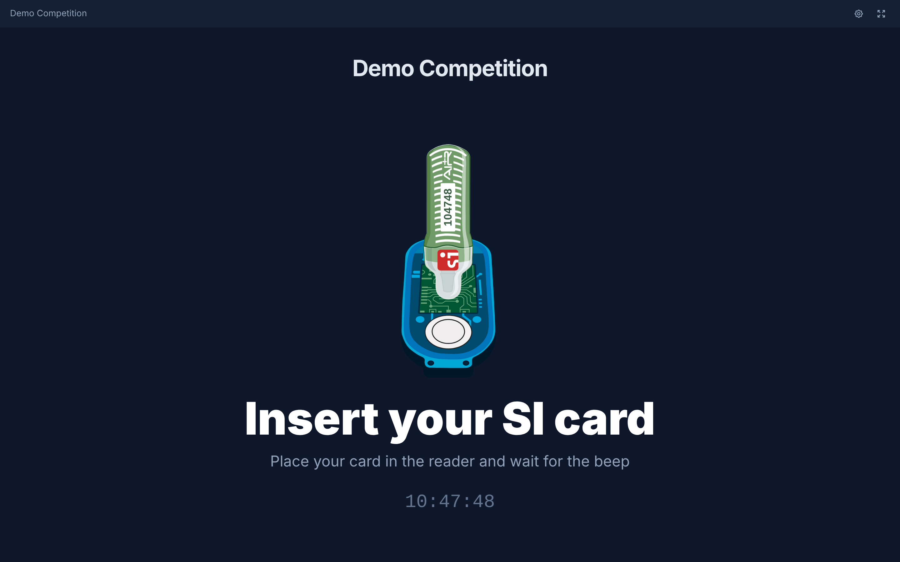
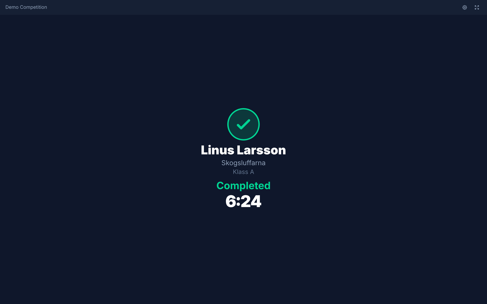
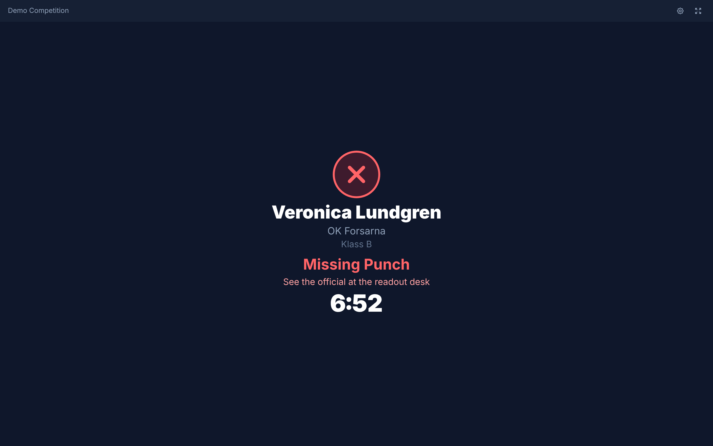
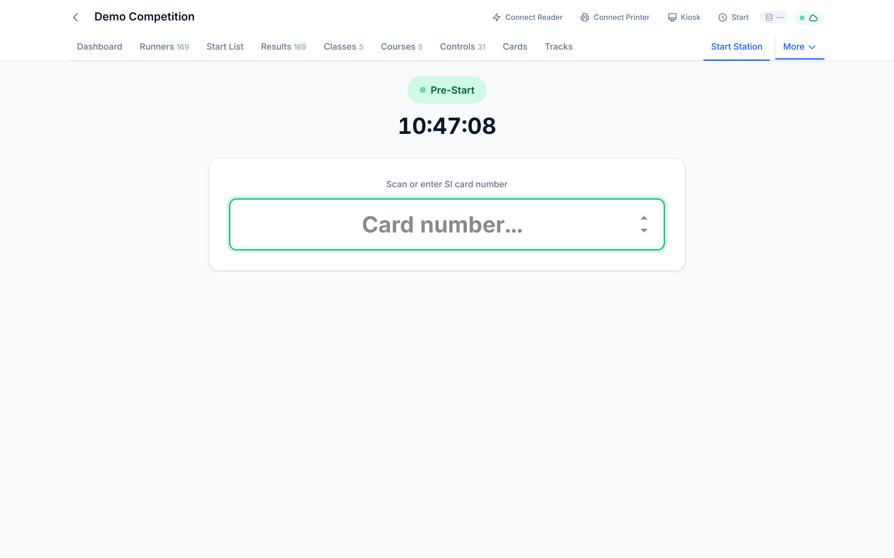
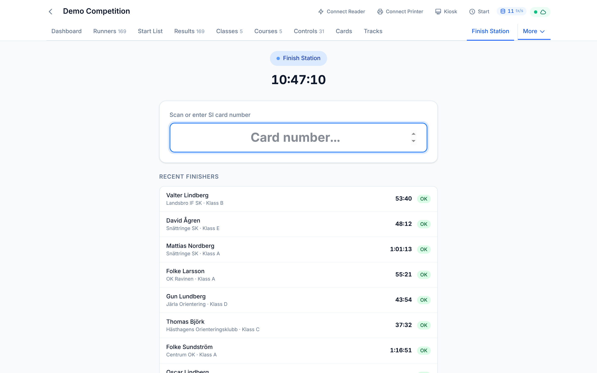
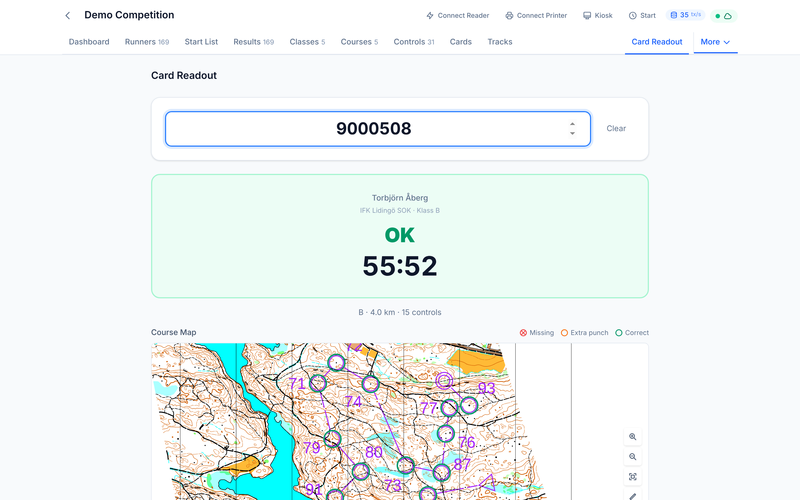
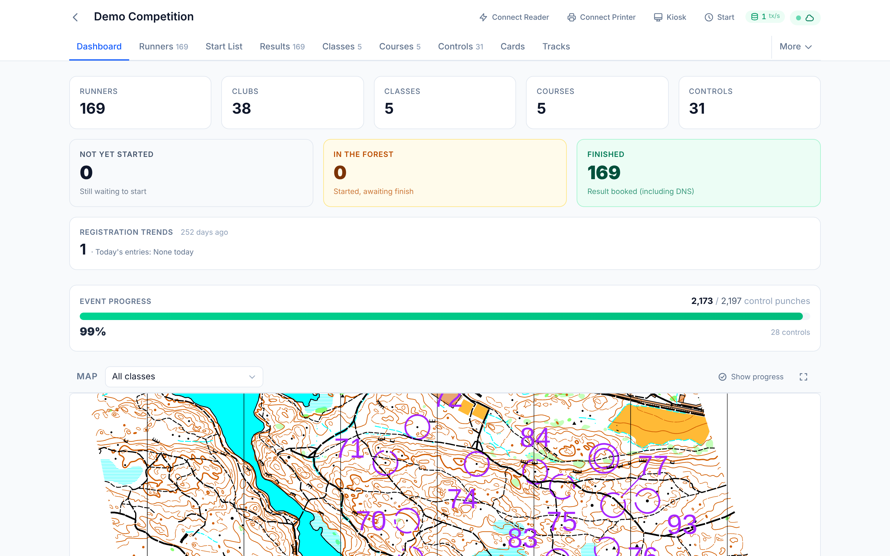
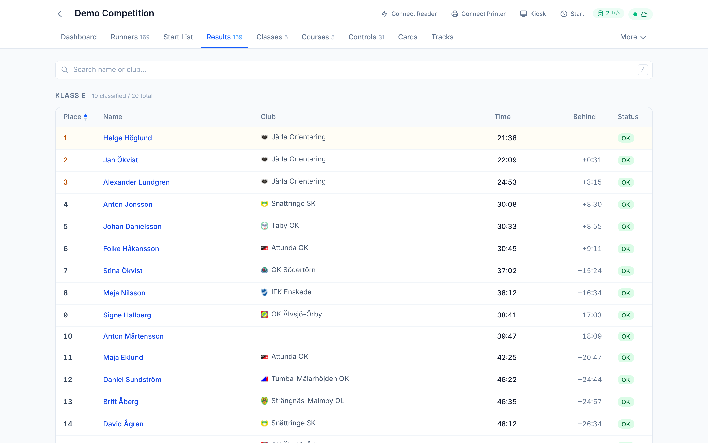
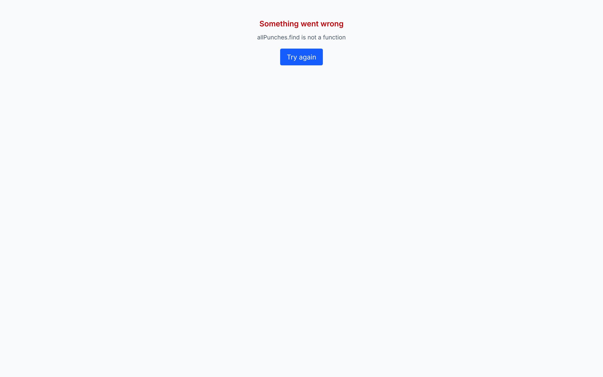

# Race day and results

Kiosk, start and finish stations, card readout, backup punches, results, cards and LiveResults. This page is the detail behind the [feature tour](../features.md).

## Kiosk mode

A self-service interface designed for a dedicated touch screen at the arena. The kiosk runs in a dark theme and communicates with the admin window via the BroadcastChannel API — no network required. See [system/registration-and-readout.md](../system/registration-and-readout.md) for the full state machine.

Idle — waiting for a card:

Successful readout — name, club, class, and total time appear the instant the card is returned:

Mispunch — the runner sees exactly what went wrong:

### When a card is not read

If the reader cannot read a card completely (the card was pulled out too early, or the transfer was damaged), the reader does not beep and nothing is saved. The kiosk says **Card not read. Insert your card again and wait for the beep.** and returns to the idle screen after a few seconds; the operator window shows a red banner "Card … was not read: insert it again". The card never shows up as a result with missing punches. If the USB reader itself is unplugged, a standalone kiosk shows a red **Reader disconnected** bar and picks the reader up again when it is plugged back in.

### When the network drops at the kiosk

A standalone kiosk keeps working without the server. A card read is saved on the device, the result is shown from the data the kiosk already holds, and a small amber badge counts the reads waiting to be sent. They are sent by themselves when the connection is back. If a read could not be saved at all, a red notice asks you to insert the card again. A kiosk opened with a kiosk key only (no one signed in, login required) keeps the reads on the device until an operator signs in there; the badge says so.

## Registration desk

An unknown card opens the **Register runner** dialog (a card notification, the Recent Cards panel, or **Add Runner** on the Runners page). Each card read starts a fresh form: the rental-card and receipt ticks and the payment method of the previous runner are not carried over, and the name filled from a card's owner data is only ever that card's owner. The payment method starts on the first method in the Registration settings.

- **Club.** The picker lists the clubs in the event and "No club". Type two letters or more in its search to also find clubs with no runner in the event yet: online it searches the club directory, offline the downloaded runner database. A club that comes with a name suggestion or a card lookup is selected even when nobody from it is entered yet.
- **A known card.** When the card already belongs to a runner, the dialog says so and **Register** stays disabled until the card is changed.
- **Errors.** A failed registration says why: the card is taken, the account may not register, the class is gone, or the server could not be reached (nothing was saved). One click registers once, however often Register is pressed while it saves.
- **Offline.** A registration made without network keeps every field (club, birth year, sex, phone, payment) and syncs when the network returns. If the server refuses it (the card belongs to someone else, or the class was removed), the Sync Status panel shows why, and the entries queued after it wait until it is retried or discarded.
- **Receipts** print after the dialog has closed or cleared, so a slow or disconnected printer never holds the desk.

**Set club** in the Runners page's bulk actions writes the club's name and its Eventor link together; picking a typed-in club clears the link.

See [system/registration-and-readout.md](../system/registration-and-readout.md) §8.

## Start and finish stations

Dedicated register-only stations for the arena — designed to run on cheap tablets and survive flaky Wi-Fi. Both stations work offline: mutations queue locally and drain when connectivity returns. Their clock (and the kiosk's and start screen's) is the event's time zone, synced with the server every 30 seconds and ticking on the device in between, so it keeps running without network and is right even on a tablet set to another zone. The Sync Status panel lists entries the server refused (for example a missing Race crew role, or a registration whose card another runner already has or whose class was removed) with the reason, and offers Retry, Retry all and Discard; a refused registration holds the entries queued after it, so the runner's finish never lands on someone else; a "Sync blocked" line says when the queue waits for a sign-in or for the server.

A runner who already has a finish is not overwritten by one Enter: the button reads **Replace finish HH:MM:SS with now** and plain Enter does nothing. A double Enter records one finish. A finish keyed in here is kept when the runner's card has no finish punch.

## Card readout

A dedicated readout workflow for organizers — type a card number (or scan one with a reader) and see the full splits table immediately, with status, course match, and per-control timing. On a forked course, a mispunch whose punches match another variant completely shows **Accept variant XX** (the red exit; see [system/registration-and-readout.md](../system/registration-and-readout.md) §4f).

Punches are matched in the order the card lists them, so a control punched by a unit with a wrong clock still counts; radio punches are slotted in by time.

**Re-reading a card never silently changes a result.** A disqualified runner or a status you set by hand stays as it is (a banner says so). A read that would replace a result with a worse one, such as a cleared hire card with no finish or punches that look like an old card's, asks first: **Replace result** or **Keep result**. Pushing a readout-station backup now writes the result too, under the same rules.

## Backup punches

SI backup-memory punches (the unit's local fallback when the chip read failed) land in a dedicated reconciliation view. Each backup punch is matched to a registered card/runner; unmatched rows are highlighted, and a one-click action pushes the reconciled punch into the `punches` table for the result engine to pick up. An imported backup punch counts for nothing until it is pushed: the readout, the Eventor upload and LiveResults only see pushed punches.

## Readout-station backup recovery

The same Backup Punches page also recovers full card readouts from a SI **readout station's** internal flash. This is the last-line-of-defence when Oxygen itself is broken and runners have read out on a standalone readout station — Oxygen wasn't there to hear the readout, but the station's own beep confirmed it landed in flash. Later, the operator dumps the flash through the Read Controls panel, reviews the recovered card readouts on the Backup Punches page's "Card readouts" tab, and pushes selected rows through the normal `storeReadout` pipeline — each one gets results, splits, and (optionally) a retroactive receipt as if it had happened live. If a page of the station's memory cannot be read, the read stops with "Backup read incomplete … nothing was cleared": nothing is imported and the station is not cleared, so read it again. "Clear after read" only runs after a complete read and a successful import. If some slots on the station could not be decoded, the row turns amber, the reader beeps three times, nothing is cleared, and "Clear memory" asks before erasing ("Clear anyway"). Full details in [`docs/system/registration-and-readout.md`](../system/registration-and-readout.md#11-readout-station-backup-memory-recovery) and [`docs/si-protocol/readout-backup-format.md`](../si-protocol/readout-backup-format.md).

## Start screen

A dedicated big-board display for the start area. The screen auto-advances to the next starting group based on the current time, showing class, name, and start time in a format readable from across a field.

## Dashboard

The race-day dashboard is the single view that answers "how are we doing?" — runner counts, clubs, classes, competition progress, and the live map with real-time control punches.

## Receipt printer

Oxygen supports direct USB receipt printing on Linux at the finish station and kiosk — no print server, no driver gymnastics. Splits, status, position, and personal best are rendered into an ESC/POS-compatible layout. See [ops/receipt-printer-setup.md](../ops/receipt-printer-setup.md) for hardware notes.

## Results

Live results update as cards are processed — OK, mispunch, DNF, over max time, out of competition, no timing. Runners with the same time share a place (1, 1, 3), the same place the finish receipt and the Eventor upload give them. A no-timing class is marked "Unofficial": its times are shown in grey and nobody is placed. Over max time and out of competition show the time without a place. Withdrawn (cancelled) entries are not on the result or start lists. Three-layer stale-punch detection ensures a card read today can't bring in phantom punches from a test run last week. See [system/registration-and-readout.md](../system/registration-and-readout.md) for the full readout pipeline.

## Cards

Every readout lands here — card type, battery, owner, current punches, and status. Click a row to expand the full punch timeline with splits, cumulative times, and OK/extra/miss badges per control.

## LiveResults push

Enable LiveResults on the event page and Oxygen will push splits to [liveresultat.se](https://liveresultat.se) on the interval you pick (typically 30 s during a race). Punches flow through the same pipeline that drives the local results view, so what's published matches what's on screen.

Radio controls are stored in LiveResults' `visit × 1000 + code` form (first punch of 82 → `1082`) so a MeOS upload to the same competition can share the radio columns. Each sync only rewrites `splitcontrols` for Oxygen's own class names; it does not wipe radios another client attached under a different class name. Do not leave Oxygen's pusher and MeOS Resultat-online running against the same `tavid` at once — they still disagree on class names (`U4` vs `U4 3 km`) and runner ids.
