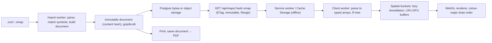
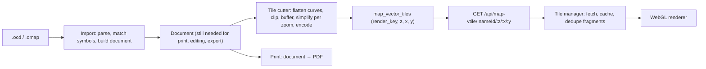

# 01 — Delivery: vector tiles vs. whole-document maps

Status: research complete; recommendation at the end awaits a decision.

## The question

The new pipeline turns an OCAD/OMAP file into a vector document in map paper
space and renders it on the GPU. How should that document reach the browser?

- **Option A — whole document.** One immutable artifact per map version. The
  client downloads it, parses it, indexes it spatially and tessellates what it
  needs, when it needs it.
- **Option B — vector tiles (MVT-style).** The server cuts the document into
  a quadtree of tiles per zoom level, clipping and simplifying geometry; the
  client fetches the tiles that cover the viewport, like today's PNG tiles but
  with vectors inside.
- **Option C — single file with an embedded spatial index.** A whole document
  whose objects are spatially sorted and indexed so that a client can fetch
  only the byte ranges covering the viewport (the FlatGeobuf / PMTiles idea).
  Objects are never split.

Two things the word "tiling" usually bundles together must be separated:

1. **Tiling as a delivery format** — what the server stores and the client
   downloads. This is the decision here.
2. **Tiling as a client render-batching strategy** — grouping geometry into
   spatial buckets so the GPU renderer can cull, tessellate incrementally and
   evict. The GL renderer needs this regardless of the delivery format, and it
   can be built from whole objects on the client. Section 6 covers it.

## 1. What is different about an orienteering map

Most of the vector-tile literature assumes a world-scale slippy map. An
orienteering map is a different object, and several of the standard
arguments for tiles do not transfer.

| Property | Slippy basemap | Orienteering event map |
|----------|----------------|------------------------|
| Coordinate space | Web Mercator, global | Map paper millimetres, one map |
| Extent | The planet | 100 mm – 1.4 m of paper (3 – 400 km²) |
| Useful zoom range | z0 – z22 (22 doublings) | ~0.25× – 8× of paper size (5 doublings) |
| Styling | Changes with zoom (roads appear, labels thin out) | Fixed: ISOM/ISSprOM symbol sizes are defined in mm and scale with the paper |
| Level of detail | Per-zoom simplification essential | Same geometry at every zoom; at most cull sub-pixel detail in overview |
| Draw order | Per layer | Global IOF colour order across the whole map (lower purple, inks, upper purple) |
| Line styling | Width, dash | Dash phase from line start, repeated symbols along the line (cliff ticks, wall dots, fence tags), tapered ends, double lines, corner points |
| Area styling | Flat fill | Flat, hatched, dotted (regular/random), pattern symbols, holes |
| Editing | Never in the viewer | Required: whiteouts, cutouts, simplification, object edits, overprint |
| Print | Not from the viewer | Same document, full fidelity, paper millimetres |
| Audience | Millions, anonymous, CDN | Tens of organisers per event, authenticated |

The narrow zoom range and the fixed styling remove the main thing a tile
pyramid is for: delivering a different, cheaper geometry per zoom. At 0.25×
we still draw essentially everything (or cull by object size, which needs no
server help); at 8× tiles are only small windows onto the same data.

## 2. Measurements

Measured on real maps from the development database (labels in the README
corpus table). Parsing uses `ocad2geojson`'s `readOcad`, the same reader the
API uses today. "JSON" is a compact whole-document encoding of every object
(symbol, type, coordinates with OCAD flags, rotation, text); "delta-varint"
is an estimate for a binary encoding with delta-coded varint coordinates.
Scripts: `measure-map.mjs`, `measure-tess.mjs` (outside the repo, see README).

### 2.1 Document size

| Map | Objects | Coordinates | Bézier segments | Paper (mm) | Terrain | JSON | JSON gzip | Delta-varint est. | Symbols used | `readOcad` |
|-----|--------:|------------:|----------------:|-----------:|--------:|-----:|----------:|------------------:|-------------:|-----------:|
| Club-full | 101 729 | 1 518 979 | 331 371 | 1362 × 1159 | 355 km² | 24.9 MB | 7.56 MB | 4.7 MB | 266 | 257 ms |
| Club-2026 | 45 884 | 640 230 | 141 239 | 326 × 438 | 32 km² | 10.8 MB | 3.20 MB | 2.0 MB | 202 | 115 ms |
| Club-old | 14 600 | 211 820 | 61 364 | 490 × 291 | 32 km² | 3.4 MB | 1.11 MB | 0.7 MB | 112 | 59 ms |
| Sprint | 10 680 | 122 422 | 16 519 | 425 × 389 | 2.6 km² | 2.0 MB | 0.63 MB | 0.43 MB | 86 | 47 ms |
| Crop-A | 4 983 | 71 084 | 19 095 | 137 × 98 | 3.0 km² | 1.0 MB | 0.34 MB | 0.22 MB | 97 | 45 ms |
| Crop-B | 3 073 | 53 395 | 15 749 | 151 × 140 | 4.8 km² | 0.8 MB | 0.26 MB | 0.16 MB | 96 | 50 ms |

Observations:

- Event maps (what the course editor and viewer actually show) are
  0.25 – 0.65 MB gzipped. That is smaller than a single photo and comparable
  to the PNG tiles a user downloads in one session today.
- The full club map — the entire mapped area at 1.36 m × 1.16 m of paper,
  far beyond anything printed for an event — is 7.5 MB gzipped as JSON and
  about 5 MB in a binary encoding. The original `.ocd` is 36 MB.
- Coordinates per object: median 6, p90 ≈ 30, p99 ≈ 100–140, maximum ≈ 3 000.
  Objects are small; the few large ones (long contours, big forest areas)
  are the only ones that would span many tiles.
- 20 – 30 % of coordinates are Bézier control points. Any clipping step has
  to flatten curves first.

### 2.2 Client-side preparation cost

Whole-document work the client must do before the first frame: flatten
Béziers (tolerance 0.02 mm, good to ~8× zoom), triangulate areas (earcut,
holes included), estimate stroke vertices, build a packed R-tree (flatbush).
Node 20 on a desktop; multiply by 3 – 5 for a mid-range phone, and note the
work runs in a worker.

| Map | Flattened coords | Triangles (areas) | earcut | Flatten + triangulate all | R-tree build | Objects in 1 km² cell | Objects in a phone viewport (50 × 110 mm) | Eager GPU estimate |
|-----|-----------------:|------------------:|-------:|--------------------------:|-------------:|----------------------:|------------------------------------------:|-------------------:|
| Club-full | 1.95 M (×1.29) | 622 k | 99 ms | 311 ms | 32 ms | 1 560 | 1 890 | ~110 MB |
| Club-2026 | 872 k (×1.36) | 271 k | 45 ms | 145 ms | 18 ms | 2 259 | 2 657 | ~49 MB |
| Sprint | 193 k (×1.57) | 110 k | 35 ms | 79 ms | 8 ms | 830 | 1 128 | ~7 MB |
| Crop-B | 79 k (×1.47) | 19 k | 9 ms | 38 ms | 4 ms | 1 725 | 1 424 | ~5 MB |

Observations:

- Preparing an entire event map eagerly costs tens of milliseconds. Even the
  full club map is a third of a second on desktop and a worst case of a
  couple of seconds on a phone — and it does not need to be done eagerly.
- A viewport holds 1 – 3 thousand objects whatever the map size. Memory and
  draw cost are bounded by the viewport, not the document, as soon as
  tessellation is lazy per spatial bucket.
- The eager GPU estimate is pessimistic (16 bytes per stroke vertex, every
  object resident). With lazy per-bucket tessellation and eviction the
  resident set is a handful of buckets, i.e. single-digit megabytes.
- Compare with today's cold path: `readOcad` + `ocadToSvg` ×2 + resvg per
  tile block, measured in seconds and the subject of
  `docs/bugfix-map-tile-cold-render-cloud-timeouts.md`.

### 2.3 Tile counts, for scale

A paper-space quadtree with 256 px tiles at 1× (≈ 67 mm of paper at 96 dpi)
over Club-full: ~340 tiles at 1×, 1 360 at 2×, 5 440 at 4×, 21 760 at 8×,
plus overview levels — roughly 29 000 tiles to cut, store and invalidate,
each carrying clipped duplicates of the objects on its borders, versus one
7.5 MB file. For an event crop the numbers are ~5 / 20 / 80 / 320 tiles; the
whole document is smaller than the four zoom levels together.

## 3. Option A — whole document

What it is: the importer produces one document per map version (keyed by a
content hash of the source file plus the importer version, exactly as
`render_key` works today). The API serves it as an immutable blob. The client
keeps it in Cache Storage and parses it in a worker into flat typed arrays
plus a packed R-tree. The renderer tessellates per spatial bucket on first
visibility and evicts buckets by LRU.

Pros:

- **Single source of truth.** Viewer, editor, print, export, OCAD
  reconstruction and any future PNG tiler read the same bytes. No second
  representation to keep in sync; no fidelity differences between screen and
  paper by construction.
- **Zero compute at view time.** Cloud Run serves a blob (or redirects to a
  signed object URL). The render-queue semaphore, the 503-when-busy path, the
  progress endpoint and the cold-start pain of the tile pipeline disappear.
- **Full fidelity.** Objects stay whole: dash phase, repeated symbols, line
  ends, random pattern seeds, text anchors, holes, Bézier curves (flattened
  adaptively on the client at whatever zoom is current).
- **Editing is natural.** Whiteouts, cutouts, map simplification, object
  edits, per-symbol visibility: all operate on whole objects already in
  memory. Edits serialise as small patches against the document.
- **Offline is one file.** Cache the document once; the whole map works at
  the venue with no coverage gaps.
- **Simplest server.** Import once, store, serve. The data path is the same
  as a map thumbnail.
- **Measured cost is small.** Event maps: < 1 MB and < 100 ms of preparation.

Cons:

- **First paint waits for the whole download.** Irrelevant for event maps
  (< 1 MB); noticeable for a full club map on a slow connection (7.5 MB at
  5 Mbit/s ≈ 12 s). Mitigations: brotli, binary encoding (≈ 5 MB), showing
  the map progressively as the stream parses if objects are spatially sorted,
  or Option C's range loading. Club-library browsing is the only place this
  bites, and a thumbnail already covers that.
- **Client memory scales with the document.** Raw typed arrays for Club-full
  are ~15 MB plus the index; fine on any device the PWA targets. GPU memory is
  bounded by visible buckets, not by the document.
- **No per-zoom LOD from the server.** Overview rendering of a huge map draws
  everything or applies client-side size culling. Measured: 100 k objects
  is a trivial draw count for WebGL once batched by colour.
- **Exposure.** Anyone with access to the map route can download the full
  vector map and reconstruct an OCAD file. This is the same information PNG
  tiles at maximum zoom expose, just in a more convenient form; it is already
  behind event authentication, and public viewers would get rasters if that
  ever ships. Accepted.

## 4. Option B — server-cut vector tiles

What it is: after import, a worker cuts a quadtree in paper space. Each tile
holds the objects intersecting it, clipped to the tile plus a buffer, with
curves flattened at a tolerance chosen for that zoom and optionally
simplified. Encoding would be MVT (protobuf, integer grid, layers, tags) or a
custom equivalent. The client fetches visible tiles through a manager very
like today's `TileLayer`.

Pros:

- **Progressive loading and bounded transfer** for arbitrarily large maps;
  the viewport decides what is downloaded.
- **Bounded client memory by construction**, without building a bucket scheme
  on the client.
- **Familiar shape.** The cache table, render-key invalidation, progress
  endpoint and client tile manager exist for PNG tiles and could be adapted.
- **CDN-friendly** if we ever served anonymous public traffic at scale.

Cons, in order of weight:

- **A second product.** Print, editing and export still need the unclipped
  document, so tiles are derived data on top of it: a cutter, a cache, an
  invalidation path and a client that reads two formats. Everything in
  Option A is still built; tiles are additional.
- **Clipping breaks orienteering line and area styling.** This is the
  decisive technical problem and it is permanent, not a one-off cost:
  - *Dash phase.* Dashes in ISOM lines (505/506/507 paths, 106 earth wall,
    416 distinct vegetation boundary, 522 fence variants) are laid out over
    the whole line from its start, with dash points forcing dash alignment.
    A clipped fragment restarts the dash pattern at the tile edge; dashes
    double or vanish at every boundary. General-purpose tile renderers have
    carried this defect for years because it has no clean fix inside a tile.
  - *Repeated symbols along lines.* Cliff ticks (201/202), wall dots, fence
    tags, power-line bars (516), vegetation boundary dots are spaced from the
    line start or centred on the line. Fragments place them wrongly; marks
    double at the seam.
  - *Line ends.* Tapered cliff ends, pointed ends, end caps: a fragment has
    two artificial ends that must not be styled as ends. Needs per-vertex
    "synthetic end" flags carried through the encoding.
  - *Random fills.* Stony ground (210), random boulder fields and similar
    seeded patterns must be seeded per object, not per fragment, or the
    dots jump at seams. Regular hatches are safe only if the shader anchors
    them in map space (which the GL renderer should do anyway).
  - *Béziers.* Curves must be flattened before clipping, fixing the maximum
    quality at cut time per zoom and multiplying coordinates across zooms.
    Whole objects can be flattened adaptively for the current zoom.
  - *Text.* Anchor-based objects cannot be clipped; they need an owning-tile
    rule plus overdraw, and text in a buffer zone is drawn twice.
  - *Identity.* An object spanning n tiles becomes n fragments with one id.
    Hover, selection, hide/show, and any map edit must stitch fragments.
  - *Holes.* Polygon-with-holes clipping is robust with a proper library but
    produces slivers and raises cutter cost and complexity.
- **Global colour order needs all visible tiles before a consistent frame.**
  The renderer must batch by colour across tiles; partial tile sets show
  objects in the wrong order until the rest arrive (visible as "popping"
  where a yellow field appears above a path for a frame).
- **The zoom pyramid buys little here.** Section 1: the same geometry is
  drawn at every zoom, so per-zoom simplification is either harmful (print
  quality lost, symbols distorted) or so conservative that the pyramid is
  mostly copies. Storage and cut time multiply by the number of levels.
- **Server work and operational surface stay.** A cutter worker with
  clipping, buffering, curve flattening, protobuf encoding and per-zoom
  policy; a tile table; cold-cut latency for the first viewer of a map
  version (the exact failure mode `bugfix-map-tile-cold-render-cloud-timeouts`
  documents, now with a lighter per-tile cost but the same shape).
- **Offline is a prefetch problem.** Covering the event area over four zoom
  levels is hundreds to thousands of requests and a coverage check; a missed
  tile at the venue is a hole in the map.
- **Editing round-trips.** A whiteout or an object edit on a tiled map means
  either re-cutting affected tiles on the server or maintaining a client-side
  overlay of the document anyway — at which point the client already has
  what Option A would have given it.

## 5. Option C — whole document with embedded spatial index and range loading

What it is: the document is written as a binary file whose objects are sorted
along a Hilbert curve by bounding-box centre, preceded by a packed static
R-tree over object bounding boxes (the flatbush layout, which FlatGeobuf uses
on disk). A client reads the header (tens of kilobytes), queries the tree for
the viewport, coalesces the resulting byte ranges and issues HTTP `Range`
requests. Objects are never split; clipping and all its problems do not
exist. Print and export read the file from start to end.

Pros:

- Progressive loading for very large maps without a tile pyramid or a cutter:
  first paint of a viewport on Club-full is a few hundred kilobytes.
- Still one artifact, one format, one source of truth.
- Additive: if Option A's format already sorts objects spatially and carries
  the index, range loading is a delivery feature added later with no format
  migration.

Cons:

- Requires a binary record layout with fixed addressing (JSON cannot be range
  loaded). This is probably desirable anyway (Section 2.1: ~40 % smaller than
  gzipped JSON, no parse step), but it is a format decision (topic 02).
- Range requests and offline do not mix well: Cache Storage caches whole
  responses, so the service worker must either fetch the whole file for
  offline anyway or implement its own range cache on top of IndexedDB.
- Server and intermediaries must honour `Range` (Fastify static and object
  stores do; some proxies strip it).
- For event maps (< 1 MB) it is pure overhead: more requests than one
  download. Only full club maps benefit, and only on slow links.

## 6. Tiling as a client render strategy (independent of delivery)

Whatever is downloaded, the GL renderer needs spatial buckets:

- Cull: draw only buckets intersecting the viewport.
- Tessellate incrementally: triangulate and extrude strokes per bucket in a
  worker on first visibility, upload as one vertex buffer per bucket per
  colour group.
- Evict: drop GPU buffers of buckets far from the viewport (LRU with a
  memory budget).

Buckets are built client-side from whole objects using the R-tree:

- A fixed grid in paper space (for example 50 × 50 mm, ≈ 0.56 km² at
  1:15 000; ~1 – 2 k objects per cell on dense maps).
- Small objects (bounding box within a cell or two) are assigned to every
  cell they overlap; dedupe by id per frame, or assign by centre and accept
  the small overdraw from neighbouring cells with a one-cell margin.
- Large objects (long contours, roads, big areas: a few thousand per map)
  go into a separate always-resident bucket, tessellated once.
- Draw order is colour-major, bucket-minor: for each IOF colour in order,
  draw that colour's buffers from every visible bucket. Order is exact
  because every object is whole and every visible bucket is resident before
  the frame is drawn (tessellation of a newly visible bucket completes in a
  few milliseconds; a frame may show the previous bucket set meanwhile).

This gives the memory and culling behaviour tiles are praised for, without
clipping, without a server cutter, and with the full document available for
hit-testing and editing. It is required work under every option — under
Option B it would merely be replaced by fragment stitching, which is harder.

## 7. Cross-cutting comparison

| Concern | A — whole document | B — vector tiles | C — indexed single file |
|---------|--------------------|------------------|--------------------------|
| Representations to maintain | 1 | 2 (document + tiles) | 1 |
| Server compute at view time | none | cutter (cold) + cache | none |
| First paint, event map (< 1 MB) | ≈ download + < 100 ms | several requests, similar | more requests, no gain |
| First paint, full club map on 5 Mbit/s | ~12 s (JSON) / ~8 s (binary) | ~1 s | ~1 s |
| Rendering fidelity | exact | permanent seam defects (dash phase, repeated symbols, ends, random fills, text) | exact |
| IOF colour order | exact | exact only when all visible tiles resident | exact |
| Client memory | document resident (≤ 15 MB raw worst case); GPU bounded by buckets | bounded | bounded; document grows as explored |
| Map editing | in place | re-cut or shadow document | in place |
| Print / export | same artifact | separate artifact | same artifact |
| Offline | one cached file | prefetch n tiles × m zooms, coverage risk | whole file for offline anyway |
| Invalidation | one content hash | per-tile cache keyed by render key | one content hash |
| Reuse of existing tile infra | retire it | adapt it | retire it |
| Future PNG tiler for public pages | derive from document | derive from document | derive from document |
| Vector exposure / OCAD reconstruction | trivial (accepted) | easy (stitch tiles) | trivial (accepted) |
| Delivery effort beyond the common core | small | large, plus ongoing fidelity work | medium, deferrable |

Common core (needed by all): importer producing the document, symbol model,
client parser, R-tree, worker tessellation, bucket scheme, GL renderer, PDF
backend. Relative delivery effort on top of that core, as a rough order of
magnitude: A ≈ 1 (blob route, cache headers, service-worker caching);
C ≈ A + 0.2 – 0.3 (binary layout with index header, range handling, range
cache); B ≈ A + 0.6 – 0.9 initially (cutter with clipping/buffering/
flattening/encoding, tile table and invalidation, tile manager, fragment
dedupe) plus a permanent tax for the seam problems, several of which have no
complete fix.

## 8. When tiles would be the right answer

For completeness, the conditions under which Option B wins, none of which
hold for Oxygen:

- Documents far larger than the client can hold (hundreds of MB to GB):
  national or continental coverage, not an event map.
- Zoom-dependent styling and generalisation as a product feature.
- Many anonymous viewers behind a CDN where per-tile caching matters more
  than fidelity.
- No requirement to edit or print from the same data.

The one scenario in Oxygen's future that resembles this — public result or
live pages showing a course on the map to spectators — is better served by
rasters: a PNG tiler that renders from the vector document with the same
render core on the server, so public pages never expose vectors and never
depend on client GPU support. That is a separate, later topic.

## 9. Recommendation

Adopt **Option A, designed so that Option C is a later additive step**, and
do not build Option B.

Concretely, for the format work in topic 02:

1. The document is one immutable artifact per map version, addressed by
   content hash (source hash + importer version), served with
   `Cache-Control: immutable` and an ETag, gzip/brotli encoded, and cached by
   the service worker for offline use.
2. Objects are stored whole, with OCAD coordinate flags and Bézier control
   points preserved; nothing is flattened, clipped or simplified at import.
3. Objects are sorted along a Hilbert curve by bounding-box centre and the
   document header carries object bounding boxes (or a packed R-tree) so the
   client can build buckets without a full pass and so range loading can be
   added without changing the format.
4. Prefer a binary layout if topic 02 confirms the size and parse-time gains
   (≈ 40 % smaller than gzipped JSON; typed arrays without a JSON parse);
   keep a JSON debug projection for tests and tooling.
5. The client renderer owns spatial bucketing (Section 6); buckets are a
   client concept and never appear in the format or the API.
6. The existing PNG tile pipeline (`map_tiles`, `/api/map-tile`, render
   queue) is retired once the GL viewer replaces `TileLayer`; a raster tiler
   for public pages, if ever needed, is re-derived from the vector document.

### Budgets to validate in the first spike

Measured on a mid-range Android phone over a throttled 4G profile, after the
service worker has the application shell:

| Metric | Event map (Crop-A/B, Sprint) | Club-full |
|--------|------------------------------|-----------|
| Document size (compressed) | ≤ 1 MB | ≤ 8 MB |
| Parse + index in worker | ≤ 150 ms | ≤ 1.5 s |
| First frame after download complete | ≤ 500 ms | ≤ 2.5 s |
| Steady-state pan/zoom at 2× | 60 fps | 60 fps |
| GPU memory, resident buckets | ≤ 30 MB | ≤ 150 MB |

If Club-full misses the first-paint budget on slow links and that matters
for club-library browsing, implement Option C's range loading; nothing else
changes.

## 10. Open questions carried forward

- Binary vs. JSON document, and the exact record layout (topic 02).
- Whether to persist a tessellation cache in IndexedDB. Measured preparation
  costs suggest it is unnecessary; revisit only if the phone spike disagrees.
- Keying of club-library maps shared across events: content hash of the
  source plus importer version is sufficient; confirm that event-level
  overrides (colour stack, rotation, crop) stay outside the document as
  view parameters.
- Bucket size and the large-object threshold (topic 04), to be tuned against
  the measurement corpus.
