# ISOM2017-2 contact sheet

<!-- Generated by `pnpm --filter @oxygen/api golden:render` — do not edit. Spec: docs/map-symbols.md §6 (d). -->

152 entries, Rev 6 (20 January 2024), library version 2026.10.1. Swatches at 10 px/mm; points drawn ×3.

| Swatch | Entry | Type | English | Svenska | Aliases |
|---|---|---|---|---|---|
|  | `101` | L | Contour | — | — |
|  | `101.b` | P | Slope line, contour | — | — |
|  | `102` | L | Index contour | — | — |
|  | `102.b` | T | Contour value | — | — |
| 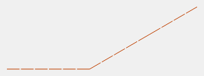 | `103` | L | Form line | — | — |
|  | `103.b` | P | Slope line, form line | — | — |
| 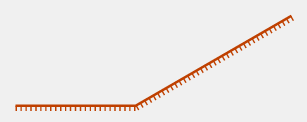 | `104` | L | Earth bank | — | — |
|  | `104.b` | L | Earth bank, top line | — | — |
|  | `104.c` | L | Earth bank, tag line | — | — |
|  | `105.1` | L | Earth wall | — | — |
|  | `105.2` | L | Retaining earth wall | — | — |
|  | `106` | L | Ruined earth wall | — | — |
|  | `107` | L | Erosion gully | — | — |
|  | `108` | L | Small erosion gully | — | — |
|  | `109` | P | Small knoll | — | — |
|  | `110` | P | Small elongated knoll | — | — |
|  | `111` | P | Small depression | — | — |
|  | `112` | P | Pit | — | — |
| 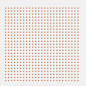 | `113` | A | Broken ground | — | — |
| 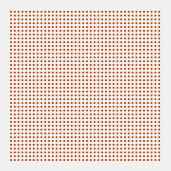 | `114` | A | Very broken ground | — | — |
|  | `115` | P | Prominent landform feature | — | — |
| 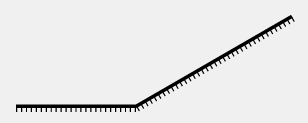 | `201` | L | Impassable cliff | — | — |
|  | `201.b` | L | Impassable cliff, top line | — | — |
|  | `201.c` | L | Impassable cliff, tag line | — | — |
|  | `202` | L | Cliff | — | — |
| 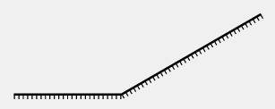 | `202.b` | L | Cliff, with tags | — | — |
|  | `203.1` | P | Rocky pit or cave | — | — |
|  | `203.2` | P | Dangerous pit | — | — |
|  | `204` | P | Boulder | — | — |
|  | `205` | P | Large boulder | — | — |
|  | `206` | A | Gigantic boulder or rock pillar | — | — |
|  | `207` | P | Boulder cluster | — | — |
|  | `207.b` | P | Boulder cluster, large | — | — |
| 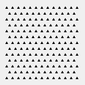 | `208` | A | Boulder field | — | — |
| 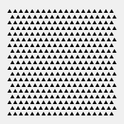 | `209` | A | Dense boulder field | — | — |
| 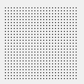 | `210` | A | Stony ground, slow running | — | — |
| 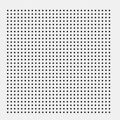 | `211` | A | Stony ground, walk | — | — |
| 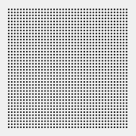 | `212` | A | Stony ground, fight | — | — |
| 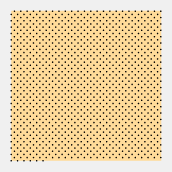 | `213` | A | Sandy ground | — | — |
|  | `214` | A | Bare rock | — | — |
|  | `215` | L | Trench | — | — |
| 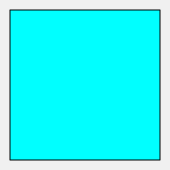 | `301` | A | Uncrossable body of water | — | — |
| 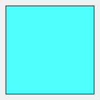 | `301.b` | A | Uncrossable body of water, dominant | — | — |
|  | `302` | A | Shallow body of water | — | — |
|  | `302.b` | A | Shallow body of water, dashed outline | — | — |
|  | `302.c` | A | Small shallow body of water, full colour | — | — |
|  | `303` | P | Waterhole | — | — |
|  | `304` | L | Crossable watercourse | — | — |
|  | `305` | L | Small crossable watercourse | — | — |
|  | `306` | L | Minor/seasonal water channel | — | — |
| 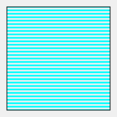 | `307` | A | Uncrossable marsh | — | — |
|  | `307.b` | A | Uncrossable marsh, no outline | — | — |
| 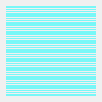 | `308` | A | Marsh | — | — |
|  | `309` | L | Narrow marsh | — | — |
| 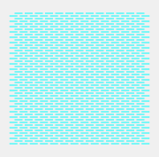 | `310` | A | Indistinct marsh | — | — |
|  | `311` | P | Well, fountain or water tank | — | — |
|  | `312` | P | Spring | — | — |
|  | `313` | P | Prominent water feature | — | — |
|  | `401` | A | Open land | — | — |
| 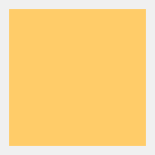 | `401.b` | A | Open land, yellow 75 % | — | — |
| 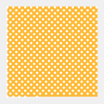 | `402` | A | Open land with scattered trees | — | — |
| 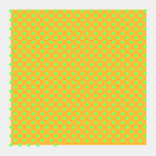 | `402.b` | A | Open land with scattered bushes | — | — |
|  | `403` | A | Rough open land | — | — |
| 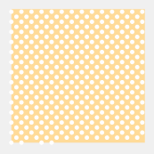 | `404` | A | Rough open land with scattered trees | — | — |
| 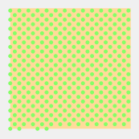 | `404.b` | A | Rough open land with scattered bushes | — | — |
|  | `405` | A | Forest | — | — |
|  | `406` | A | Vegetation: slow running | — | — |
|  | `406.b` | A | Vegetation: slow running, normal running in one direction | — | — |
| 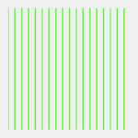 | `407` | A | Vegetation: slow running, good visibility | — | — |
|  | `408` | A | Vegetation: walk | — | — |
|  | `408.b` | A | Vegetation: walk, normal running in one direction | — | — |
| 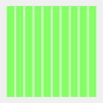 | `408.c` | A | Vegetation: walk, slow running in one direction | — | — |
|  | `409` | A | Vegetation: walk, good visibility | — | — |
|  | `410` | A | Vegetation: fight | — | — |
|  | `410.b` | A | Vegetation: fight, normal running in one direction | — | — |
|  | `410.c` | A | Vegetation: fight, slow running in one direction | — | — |
| 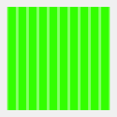 | `410.d` | A | Vegetation: fight, walk in one direction | — | — |
| 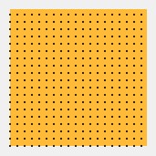 | `412` | A | Cultivated land | — | — |
| 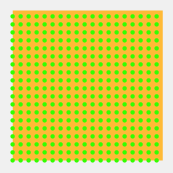 | `413` | A | Orchard | — | — |
| 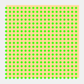 | `413.b` | A | Orchard, rough open land | — | — |
| 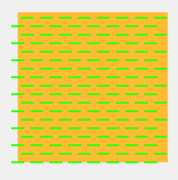 | `414` | A | Vineyard or similar | — | — |
| 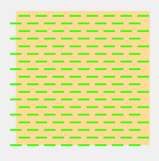 | `414.b` | A | Vineyard or similar, rough open land | — | — |
|  | `415` | L | Distinct cultivation boundary | — | — |
|  | `416` | L | Distinct vegetation boundary | — | — |
|  | `416.b` | L | Distinct vegetation boundary, green dashed line | — | — |
|  | `417` | P | Prominent large tree | — | — |
|  | `418` | P | Prominent bush or tree | — | — |
|  | `419` | P | Prominent vegetation feature | — | — |
|  | `501` | A | Paved area | — | — |
|  | `501.b` | A | Paved area, no edge line | — | — |
| 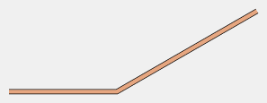 | `502` | L | Wide road | — | — |
|  | `503` | L | Road | — | — |
|  | `504` | L | Vehicle track | — | — |
| 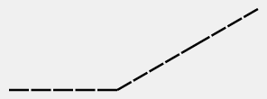 | `505` | L | Footpath | — | — |
| 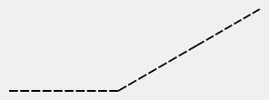 | `506` | L | Small footpath | — | — |
|  | `507` | L | Less distinct small footpath | — | — |
|  | `508` | L | Narrow ride or linear trace through the terrain | — | — |
| 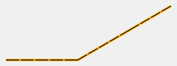 | `508.b` | L | Narrow ride, easy running | — | — |
|  | `508.c` | L | Narrow ride, normal runnability | — | — |
|  | `508.d` | L | Narrow ride, slow running | — | — |
|  | `508.e` | L | Narrow ride, walk | — | — |
| 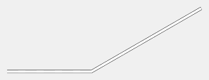 | `509` | L | Railway | — | — |
|  | `510` | L | Power line, cableway or skilift | — | — |
| 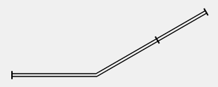 | `511` | L | Major power line | — | — |
|  | `511.b` | L | Major power line, with pylons | — | — |
| 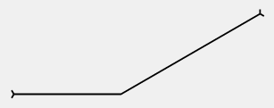 | `512` | L | Bridge / tunnel | — | — |
|  | `512.b` | L | Bridge / tunnel, one side | — | — |
|  | `513.1` | L | Wall | — | — |
| 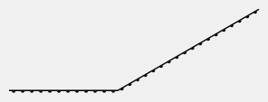 | `513.2` | L | Retaining wall | — | — |
| 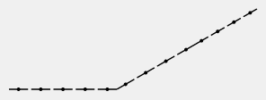 | `514` | L | Ruined wall | — | — |
| 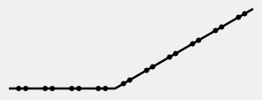 | `515` | L | Impassable wall | — | — |
|  | `516` | L | Fence | — | — |
| 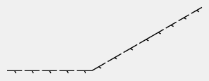 | `517` | L | Ruined fence | — | — |
|  | `518` | L | Impassable fence | — | — |
|  | `519` | P | Crossing point | — | — |
|  | `520` | A | Area that shall not be entered | — | — |
| 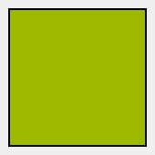 | `520.b` | A | Area that shall not be entered, with boundary | — | — |
|  | `521` | A | Building | — | — |
| 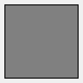 | `521.b` | A | Building, large | — | — |
|  | `522` | A | Canopy | — | — |
|  | `522.b` | A | Canopy, no outline | — | — |
| 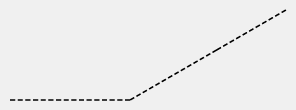 | `523` | L | Ruin | — | — |
|  | `524` | P | High tower | — | — |
|  | `525` | P | Small tower | — | — |
|  | `526` | P | Cairn | — | — |
|  | `527` | P | Fodder rack | — | — |
| 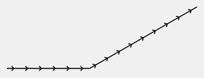 | `528` | L | Prominent line feature | — | — |
|  | `529` | L | Prominent uncrossable line feature | — | — |
|  | `530` | P | Prominent man-made feature – ring | — | — |
|  | `531` | P | Prominent man-made feature – x | — | — |
|  | `532` | L | Stairway | — | — |
|  | `601` | L | Magnetic north line | — | — |
|  | `601.b` | L | Magnetic north line, blue | — | — |
|  | `602` | P | Registration mark | — | — |
|  | `603` | P | Spot height | — | — |
|  | `603.b` | T | Spot height, value | — | — |
|  | `701` | P | Start | — | — |
|  | `702` | P | Map issue point | — | — |
|  | `703` | P | Control point | — | — |
|  | `704` | T | Control number | — | — |
|  | `705` | L | Course line | — | — |
|  | `706` | P | Finish | — | — |
|  | `707` | L | Marked route | — | — |
|  | `708` | L | Out-of-bounds boundary | — | — |
|  | `709` | A | Out-of-bounds area | — | — |
| 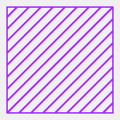 | `709.b` | A | Out-of-bounds area, solid boundary | — | — |
| 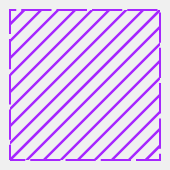 | `709.c` | A | Out-of-bounds area, dashed boundary | — | — |
|  | `710` | L | Crossing point | — | — |
|  | `711` | L | Out-of-bounds route | — | — |
|  | `712` | P | First aid post | — | — |
|  | `713` | P | Refreshment point | — | — |
|  | `715` | P | Continuing point after map exchange | — | — |
