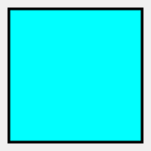
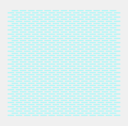
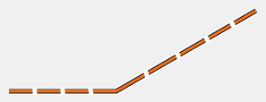
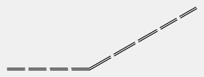
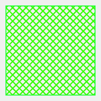
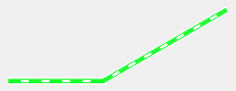
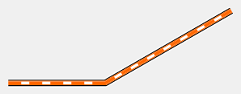

# ISSkiOM2019 contact sheet

<!-- Generated by `pnpm --filter @oxygen/api golden:render` — do not edit. Spec: docs/map-symbols.md §6 (d). -->

16 entries, Revision 4 (September 2026), library version 2026.11.1. Swatches at 10 px/mm; points drawn ×3.

Svenska: none found. Aliases: none yet.

| Swatch | Entry | Type | English | Svenska | Aliases |
|---|---|---|---|---|---|
|  | `301.1` | A | Crossable body of water | — | — |
|  | `301.2` | A | Body of water that shall not be crossed | — | — |
|  | `310.1` | A | Marsh (in ski orienteering map) | — | — |
|  | `801.1` | L | Very wide track > 3.0 m | — | — |
|  | `801.2` | L | Very wide track > 3.0 m, compulsory to stay on | — | — |
|  | `802.1` | L | Wide track 1.5 - 3.0 m | — | — |
|  | `802.2` | L | Wide track 1.5 - 3.0 m, compulsory to stay on | — | — |
|  | `803.1` | L | Track 0.8 - 1.2 m | — | — |
|  | `803.2` | L | Track 0.8 - 1.2 m, compulsory to stay on | — | — |
|  | `804.1` | L | Track, slow 0.8 - 1.0 m | — | — |
|  | `804.2` | L | Track, slow 0.8 - 1.0 m, compulsory to stay on | — | — |
|  | `805` | L | Road covered with snow | — | — |
|  | `807` | L | Unploughed road | — | — |
|  | `808` | A | Prepared area | — | — |
|  | `813.1` | L | Public snow mobile route | — | — |
|  | `813.2` | L | Public snow mobile route, compulsory to stay on | — | — |
