# ISSprOM2019-2 contact sheet

<!-- Generated by `pnpm --filter @oxygen/api golden:render` — do not edit. Spec: docs/map-symbols.md §6 (d). -->

141 entries, Rev 6 (1 February 2024), library version 2026.10.1. Swatches at 10 px/mm; points drawn ×3.

Svenska: ISSprOM 2019-2 Internationella Sprintnormen, svensk översättning, revision 5 (Svenska Orienteringsförbundet, 1 oktober 2022), CC BY-ND 4.0. Aliases: none yet.

| Swatch | Entry | Type | English | Svenska | Aliases |
|---|---|---|---|---|---|
|  | `101` | L | Contour | Höjdkurva | — |
|  | `101.b` | P | Slope line, contour | Höjdkurva, lutningsstreck | — |
|  | `102` | L | Index contour | Stödkurva | — |
| 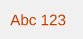 | `102.b` | T | Contour value | Stödkurva, höjdsiffra | — |
| 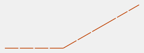 | `103` | L | Form line | Hjälpkurva | — |
|  | `103.b` | P | Slope line, form line | Hjälpkurva, lutningsstreck | — |
| 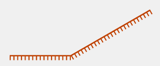 | `104` | L | Earth bank | Skärning | — |
| 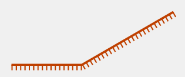 | `104.b` | L | Earth bank, very high | Skärning, mycket hög | — |
|  | `104.c` | L | Earth bank, top line | Skärning, överkantslinje | — |
|  | `104.d` | L | Earth bank, tag line | Skärning, taggar | — |
| 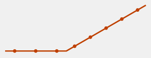 | `105.1` | L | Small earth wall | Liten jordvall | — |
|  | `105.2` | L | Retaining earth wall seen only from one side | — | — |
| 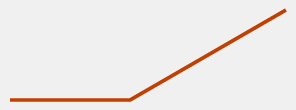 | `107` | L | Erosion gully | Erosionsfåra | — |
|  | `108` | L | Small erosion gully | Liten fåra | — |
|  | `109` | P | Small knoll | Punkthöjd | — |
| 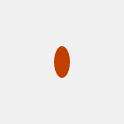 | `110` | P | Small elongated knoll | Avlång punkthöjd | — |
|  | `111` | P | Small depression | Liten grop | — |
|  | `112` | P | Pit or hole | Liten grop med branta sidor | — |
| 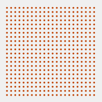 | `113` | A | Broken ground | Småkuperad terräng | — |
|  | `115` | P | Prominent landform feature | Tydligt terrängföremål | — |
| 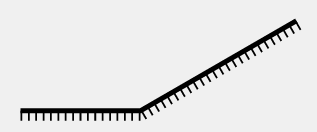 | `201` | L | Uncrossable cliff | Opasserbar brant | — |
|  | `201.b` | L | Uncrossable cliff, top line | Opasserbar brant, överkantslinje | — |
|  | `201.c` | L | Uncrossable cliff, tag line | Opasserbar brant, taggar | — |
|  | `202` | L | Passable rock face | Passerbar brant | — |
| 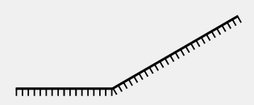 | `202.b` | L | Passable rock face, with tags | Passerbar brant, med taggar | — |
|  | `203` | P | Rocky pit or cave | Stenig grop eller grotta | — |
|  | `204` | P | Boulder | Sten | — |
|  | `205` | P | Large boulder | Stor sten | — |
|  | `206` | A | Gigantic boulder or rock pillar | Gigantisk sten eller stenpelare | — |
| 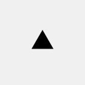 | `207` | P | Boulder cluster | Grupp av stenar | — |
| 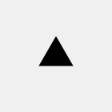 | `207.b` | P | Boulder cluster, large | Grupp av stenar, stor | — |
| 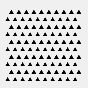 | `208` | A | Boulder field | Blockterräng | — |
| 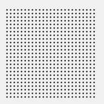 | `210` | A | Stony ground | Stenig mark | — |
| 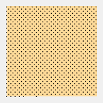 | `213` | A | Open sandy ground | Öppet sandområde | — |
|  | `214` | A | Bare rock | Berg i dagen | — |
| 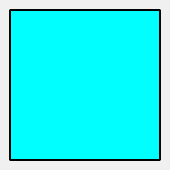 | `301` | A | Uncrossable body of water | Opasserbar vattenyta | — |
| 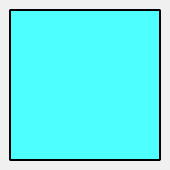 | `301.b` | A | Uncrossable body of water, dominant | Opasserbar vattenyta, dominerande | — |
| 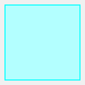 | `302` | A | Shallow body of water | Passerbar vattenyta | — |
|  | `303` | P | Waterhole | Vattenhål | — |
| 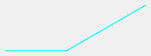 | `305` | L | Small crossable watercourse | Litet passerbart vattendrag | — |
| 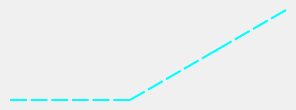 | `306` | L | Minor / seasonal watercourse | Mindre vattendrag | — |
| 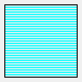 | `307` | A | Uncrossable marsh | Opasserbar sankmark | — |
| 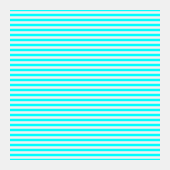 | `307.b` | A | Uncrossable marsh, no outline | Opasserbar sankmark, utan kontur | — |
| 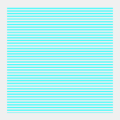 | `308` | A | Marsh | Sankmark | — |
| 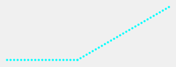 | `309` | L | Narrow marsh | Smal sankmark | — |
| 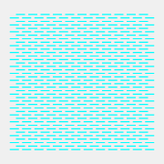 | `310` | A | Indistinct marsh | Otydlig sankmark | — |
|  | `311` | P | Small fountain or well | Liten fontän eller brunn | — |
|  | `312` | P | Spring | Källa | — |
|  | `313` | P | Prominent water feature | Tydligt vattenföremål | — |
|  | `401` | A | Open land | Öppen lättlöpt mark | — |
| 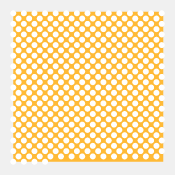 | `402` | A | Open land with scattered trees | Öppen lättlöpt mark med spridda träd | — |
| 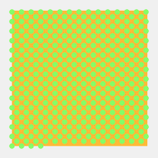 | `402.b` | A | Open land with scattered bushes | Öppen lättlöpt mark med spridda träd, spridda buskar | — |
| 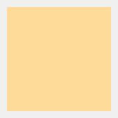 | `403` | A | Rough open land | Öppen mark med normal löpbarhet | — |
| 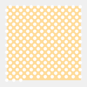 | `404` | A | Rough open land with scattered trees | Öppen mark med normal löpbarhet och spridda träd | — |
| 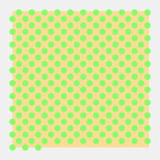 | `404.b` | A | Rough open land with scattered bushes | Öppen mark med normal löpbarhet och spridda träd, spridda buskar | — |
|  | `405` | A | Forest | Skog | — |
|  | `406` | A | Vegetation: slow running | Vegetation, löphindrande | — |
| 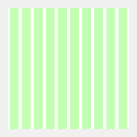 | `406.b` | A | Vegetation: slow running, normal running in one direction | Vegetation, löphindrande, normal löpbarhet i en riktning | — |
|  | `407` | A | Vegetation: slow running, good visibility | Undervegetation, löphindrande, god sikt | — |
| 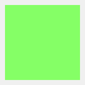 | `408` | A | Vegetation: walk | Vegetation, svårlöpt | — |
|  | `408.b` | A | Vegetation: walk, normal running in one direction | Vegetation, svårlöpt, normal löpbarhet i en riktning | — |
|  | `408.c` | A | Vegetation: walk, slow running in one direction | Vegetation, svårlöpt, löphindrande i en riktning | — |
| 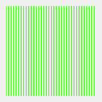 | `409` | A | Vegetation: walk, good visibility | Undervegetation, svårlöpt, god sikt | — |
| 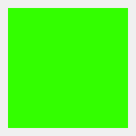 | `410` | A | Vegetation: fight | Vegetation, mycket svårframkomlig | — |
|  | `410.b` | A | Vegetation: fight, normal running in one direction | Vegetation, mycket svårframkomlig, normal löpbarhet i en riktning | — |
|  | `410.c` | A | Vegetation: fight, slow running in one direction | Vegetation, mycket svårframkomlig, löphindrande i en riktning | — |
|  | `410.d` | A | Vegetation: fight, walk in one direction | Vegetation, mycket svårframkomlig, svårlöpt i en riktning | — |
| 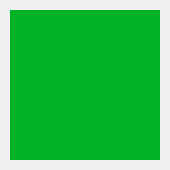 | `411` | A | Uncrossable vegetation | Vegetation, opasserbar | — |
| 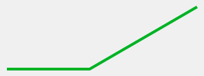 | `411.b` | L | Uncrossable vegetation, minimum width | Vegetation, opasserbar, minsta bredd | — |
|  | `412` | A | Cultivated land | Odlad mark | — |
| 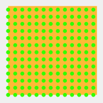 | `413` | A | Orchard | Fruktodling | — |
| 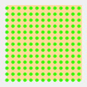 | `413.b` | A | Orchard, rough open land | Fruktodling, på öppen mark | — |
| 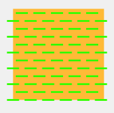 | `414` | A | Vineyard or similar | Vingård eller liknande | — |
| 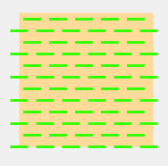 | `414.b` | A | Vineyard or similar, rough open land | Vingård eller liknande, på öppen mark | — |
| 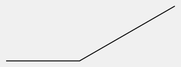 | `415` | L | Distinct cultivation boundary | Exakt begränsningslinje | — |
| 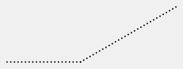 | `416` | L | Distinct vegetation boundary | Tydlig beståndsgräns | — |
|  | `417` | P | Prominent large tree | Tydligt stort träd | — |
|  | `418` | P | Prominent bush or small tree | Tydlig buske eller litet träd | — |
|  | `419` | P | Prominent vegetation feature | Tydligt vegetationsföremål | — |
| 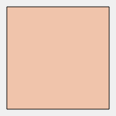 | `501` | A | Paved area | Belagd yta | — |
|  | `501.b` | A | Paved area, heavy traffic | Belagd yta, tät trafik | — |
| 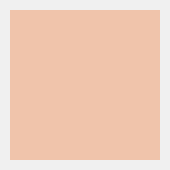 | `501.c` | A | Paved area, no edge line | Belagd yta, utan kantlinje | — |
| 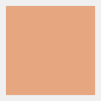 | `501.d` | A | Paved area, heavy traffic, no edge line | Belagd yta, tät trafik, utan kantlinje | — |
|  | `501.e` | L | Paved area, light traffic, as line | Belagd yta, lätt trafik, som linje | — |
|  | `501.f` | L | Paved area, heavy traffic, as line | Belagd yta, tät trafik, som linje | — |
|  | `501.1` | L | Step or edge of paved area | Steg eller kant av belagd yta | — |
| 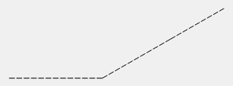 | `501.2` | L | Step or edge of paved area at lower level | Steg eller kant av belagd yta på lägre nivån | — |
| 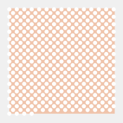 | `501.3` | A | Paved area with scattered trees | Belagd yta med spridda träd | — |
| 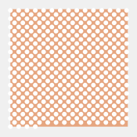 | `501.3.b` | A | Paved area with scattered trees, heavy traffic | Belagd yta med spridda träd, tät trafik | — |
|  | `505` | L | Unpaved footpath or track | Stig eller spår utan belagd yta | — |
| 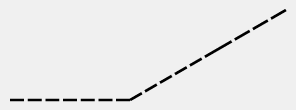 | `506` | L | Small unpaved footpath or track | Liten stig eller spår utan belagd yta | — |
| 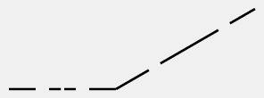 | `507` | L | Less distinct small path | Otydlig liten stig | — |
|  | `508` | L | Narrow ride | Rågång | — |
|  | `509.1` | L | Railway | Järnväg | — |
|  | `509.2` | L | Tramway | Spårväg | — |
|  | `510` | L | Power line, cableway or ski lift | Kraftledning, linbana eller skidlift | — |
|  | `511` | L | Major power line | Större kraftledning | — |
|  | `511.b` | L | Major power line, with pylons | Större kraftledning, med stolpar | — |
|  | `512.1` | L | Bridge or tunnel entrance | Bro eller tunnelmynning | — |
|  | `512.2` | L | Underpass or tunnel | Undergång eller tunnel | — |
|  | `512.3` | A | Area runnable at lower level | Område passerbart på två nivåer | — |
|  | `513.1` | L | Passable wall | Passerbar mur | — |
|  | `513.2` | L | Passable retaining wall | Passerbar stödmur | — |
|  | `515` | L | Uncrossable wall | Opasserbar mur | — |
|  | `516` | L | Passable fence or railing | Passerbart stängsel eller räcke | — |
|  | `518` | L | Uncrossable fence or railing | Opasserbart stängsel eller räcke | — |
|  | `519` | P | Crossing point (optional) | Genomgång | — |
|  | `520` | A | Area that shall not be entered | Område som inte ska beträdas | — |
|  | `520.b` | A | Area that shall not be entered, with boundary | Område som inte ska beträdas, med kontur | — |
|  | `521` | A | Building | Byggnad | — |
|  | `522` | A | Canopy | Skärmtak | — |
|  | `522.b` | A | Canopy, no outline | Skärmtak, utan kontur | — |
|  | `522.1` | P | Pillar | Pelare | — |
|  | `524` | P | High tower | Högt torn | — |
|  | `525` | P | Small tower | Litet torn | — |
|  | `526` | P | Cairn, memorial, sculpture, small monument or boundary stone | Röse, minnessten, litet monument eller gränssten | — |
|  | `527` | P | Fodder rack | Foderhäck | — |
|  | `528` | L | Prominent line feature | Tydligt linjeföremål | — |
|  | `529` | L | Prominent uncrossable line feature | Tydligt opasserbart linjeföremål | — |
|  | `530` | P | Prominent man-made feature – ring | Tydligt människoframställt föremål - ring | — |
|  | `531` | P | Prominent man-made feature – x | Övrigt tydligt människoframställt föremål - x | — |
|  | `532` | L | Stairway | Trappa | — |
|  | `533` | A | Area with obstacles | — | — |
|  | `601` | L | Magnetic north line | Magnetisk nordlinje | — |
|  | `601.b` | L | Magnetic north line, blue | Magnetisk nordlinje, blå | — |
|  | `701` | P | Start | Start | — |
|  | `702` | P | Map issue point | Kartutdelningsplats | — |
|  | `703` | P | Control point | Kontrollpunkt | — |
|  | `704` | T | Control number | Kontrollsiffror | — |
|  | `704.b` | T | Control number, with white outline | Kontrollsiffror, med vit kontur | — |
|  | `705` | L | Course line | Sammanbindningslinjer | — |
|  | `706` | P | Finish | Mål | — |
|  | `707` | L | Marked route | Snitslad rutt | — |
|  | `708` | L | Out-of-bounds boundary | Gräns förbjuden att passera | — |
|  | `709` | A | Out-of-bounds area | Förbjudet område | — |
|  | `709.b` | A | Out-of-bounds area, solid boundary | Förbjudet område, heldragen kontur | — |
|  | `709.c` | A | Out-of-bounds area, dashed boundary | Förbjudet område, streckad kontur | — |
|  | `710.1` | P | Crossing point | Passeringspunkt | — |
|  | `710.2` | L | Crossing section | Passeringsområde | — |
|  | `714` | A | Temporary construction or closed area | Tillfällig konstruktion eller avstängd yta | — |
|  | `715` | P | Continuing point after map exchange | — | — |
